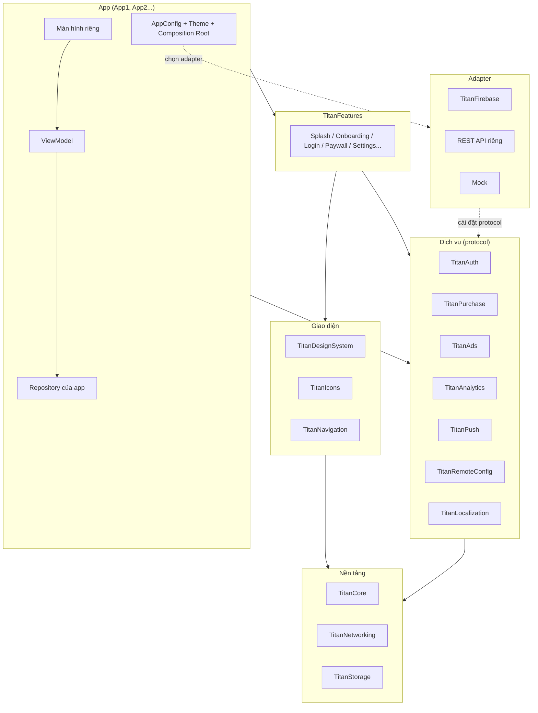
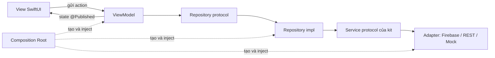
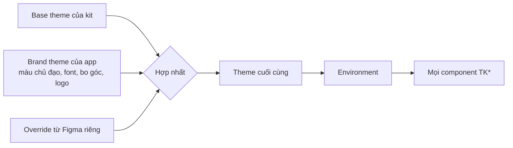
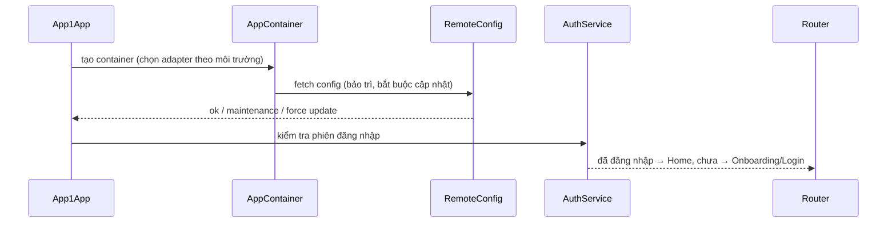

# TitanKit – Tổng quan kiến trúc

TitanKit là bộ kit iOS dùng chung cho nhiều app. Mỗi app có giao diện và cấu hình riêng nhưng dùng chung code nền, design system, dịch vụ và các màn hình dựng sẵn. App 1 là app đầu tiên được xây trên kit.

Tài liệu này là điểm bắt đầu. Đọc hết file này rồi đi vào từng module ở [mục 9](#9-danh-mục-tài-liệu-module).

> Trạng thái: bản thảo, chờ Jack duyệt. Các lựa chọn đánh dấu (đề xuất) có thể đổi.

---

## 1. Nguyên tắc

1. **App dùng kit, kit không biết app.** Phụ thuộc chỉ đi một chiều. Không app nào import code của app khác.
2. **Không khóa vào nhà cung cấp.** Firebase, AdMob, RevenueCat... chỉ là adapter cắm vào protocol của kit. Đổi nhà cung cấp là viết adapter mới, không sửa màn hình.
3. **Không design vẫn làm được app.** Base theme và màn hình dựng sẵn đủ để ráp một app hoàn chỉnh. Design riêng chỉ ghi đè.
4. **Chỉ kéo vào thứ cần dùng.** Mỗi dịch vụ là một module riêng. App không có quảng cáo thì không có SDK quảng cáo.
5. **Dễ test.** Mọi phụ thuộc đi qua protocol, mọi service có bản Mock.

## 2. Công nghệ (đề xuất)

| Hạng mục | Lựa chọn |
| --- | --- |
| UI | SwiftUI |
| iOS tối thiểu | 16.0 |
| Ngôn ngữ | Swift 6, async/await |
| Module | Swift Package Manager |
| Sinh project | Tuist |
| Backend hiện tại | Firebase (qua adapter) |
| CI/CD | GitHub Actions + fastlane |

## 3. Kiến trúc tổng thể

Hệ thống chia thành 4 tầng. Tầng trên chỉ gọi tầng dưới qua protocol.



| Tầng | Module | Ai dùng |
| --- | --- | --- |
| Nền tảng | TitanCore, TitanNetworking, TitanStorage | Mọi module |
| Giao diện | TitanDesignSystem, TitanIcons, TitanNavigation | Features, App |
| Dịch vụ | TitanAuth, TitanPurchase, TitanAds, TitanAnalytics, TitanPush, TitanRemoteConfig, TitanLocalization | Features, App (chỉ module được bật) |
| Màn hình | TitanFeatures | App |
| Adapter | TitanFirebase, TitanREST, Mock | Chỉ Composition Root của app |

## 4. Kiến trúc bên trong một app

Mỗi app dùng **MVVM + Repository**, khởi tạo mọi thứ ở một chỗ duy nhất là **Composition Root**.



- **View**: chỉ vẽ giao diện từ state, không gọi network.
- **ViewModel**: `@MainActor final class ... : ObservableObject`, giữ state màn hình, gọi Repository.
- **Repository**: giao diện dữ liệu theo nghiệp vụ của app (`UserRepository`, `WorkoutRepository`...). Trả về model Swift thuần.
- **Service**: protocol của kit (`AuthService`, `DataService`...). Repository dùng Service, không dùng SDK.
- **Adapter**: cài đặt Service bằng SDK cụ thể.
- **Composition Root**: file `AppContainer.swift` trong app, tạo adapter, service, repository và đưa vào Environment.

## 5. Design pattern sử dụng

| Pattern | Dùng ở đâu | Vì sao |
| --- | --- | --- |
| MVVM | Mọi màn hình | Tách giao diện và logic, test được ViewModel |
| Repository | Tầng dữ liệu của app | Màn hình không biết dữ liệu đến từ Firebase hay API |
| Adapter | Backend, quảng cáo, analytics, purchase | Đổi nhà cung cấp mà không sửa app |
| Dependency Injection (Composition Root) | `AppContainer` của mỗi app | Một chỗ duy nhất quyết định dùng cài đặt nào, dễ thay Mock khi test |
| Router / Coordinator | TitanNavigation | Điều hướng bằng enum `Route`, hỗ trợ deep link |
| Environment injection | Theme, container | SwiftUI truyền theme và service xuống mọi view |
| Builder / Endpoint | TitanNetworking | Mô tả request bằng struct, dễ đọc, dễ test |
| Chain of Responsibility | Interceptor của TitanNetworking | Gắn token, retry, log theo chuỗi |
| Composite | TitanAnalytics | Gửi một sự kiện tới nhiều nhà cung cấp cùng lúc |
| Strategy | Theme, cấu hình feature | Đổi hành vi bằng cấu hình, không sửa code |
| Facade | Mỗi module dịch vụ | App gọi một API gọn, bên trong lo phần phức tạp |

## 6. Hệ thống theme 3 lớp



Lớp sau thắng lớp trước. Component chỉ dùng token semantic (`color.action.primary`), không dùng mã màu trực tiếp. Chi tiết ở [DesignSystem.md](modules/DesignSystem.md).

## 7. Cấu trúc repo

```
titankit/
├── Packages/TitanKit/
│   ├── Package.swift
│   ├── Sources/<Module>/
│   └── Tests/<Module>Tests/
├── Adapters/TitanFirebase/       # tách riêng để kit không phụ thuộc Firebase SDK
├── Apps/
│   └── App1/
│       ├── Sources/
│       │   ├── AppContainer.swift  # Composition Root
│       │   ├── AppConfig.swift
│       │   └── Features/<Màn hình>/{View, ViewModel}.swift
│       ├── Resources/
│       ├── Theme/
│       └── Config/{Dev,Staging,Prod}.xcconfig
├── Catalog/                      # app xem trước component và theme
├── Templates/NewApp/             # mẫu Tuist tạo app mới
├── Tokens/                       # JSON token từ Figma
├── Tools/                        # script sinh code
├── docs/                         # bộ tài liệu này
├── fastlane/
├── .github/workflows/
└── Tuist/ + Project.swift
```

## 8. Luồng khởi động một app



## 9. Danh mục tài liệu module

| Nhóm | Module | Tài liệu |
| --- | --- | --- |
| Nền tảng | TitanCore | [Core.md](modules/Core.md) |
| Nền tảng | TitanNetworking | [Networking.md](modules/Networking.md) |
| Nền tảng | TitanStorage | [Storage.md](modules/Storage.md) |
| Giao diện | TitanDesignSystem | [DesignSystem.md](modules/DesignSystem.md) |
| Giao diện | TitanIcons | [Icons.md](modules/Icons.md) |
| Giao diện | TitanNavigation | [Navigation.md](modules/Navigation.md) |
| Dịch vụ | Backend & adapter | [Backend.md](modules/Backend.md) |
| Dịch vụ | TitanAuth | [Auth.md](modules/Auth.md) |
| Dịch vụ | TitanPurchase | [Purchase.md](modules/Purchase.md) |
| Dịch vụ | TitanAds | [Ads.md](modules/Ads.md) |
| Dịch vụ | TitanAnalytics | [Analytics.md](modules/Analytics.md) |
| Dịch vụ | TitanPush | [Push.md](modules/Push.md) |
| Dịch vụ | TitanRemoteConfig | [RemoteConfig.md](modules/RemoteConfig.md) |
| Dịch vụ | TitanLocalization | [Localization.md](modules/Localization.md) |
| Dịch vụ | TitanSpeech | [Speech.md](modules/Speech.md) |
| Dịch vụ | TitanAI | [AI.md](modules/AI.md) |
| Màn hình | TitanFeatures | [Features.md](modules/Features.md) |
| Công cụ | Tạo app, môi trường, CI/CD | [Tooling.md](modules/Tooling.md) |
| Quy định | Privacy, App Store | [Compliance.md](modules/Compliance.md) |
| Quy ước | Đặt tên, git, code style | [Conventions.md](Conventions.md) |
| Bắt đầu | Kế hoạch làm App 1 | [App1-Plan.md](App1-Plan.md) |

## 10. Phạm vi

| Mức | Hạng mục |
| --- | --- |
| Làm ngay | Toàn bộ module ở mục 9, privacy manifest + ATT + GDPR, xóa tài khoản, môi trường dev/staging/prod, xử lý lỗi và mất mạng, Catalog, cache ảnh, bảo trì/bắt buộc cập nhật, deep link, snapshot test, phiên bản kit |
| Làm sau | Đồng bộ offline, widget, App Clip, bảo mật nâng cao, A/B test paywall |
