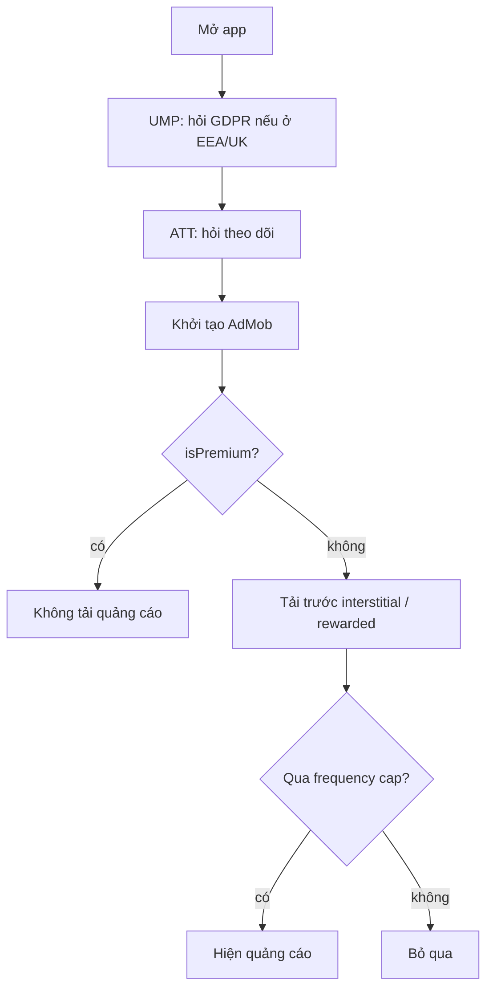

# TitanAds

[← Về tổng quan](../README.md) · [Backend & adapter](Backend.md)

TitanAds hiển thị quảng cáo banner, xen kẽ (interstitial) và có thưởng (rewarded) sau khi đã xin đủ sự đồng ý, và tự tắt với người dùng premium.

## 1. Trách nhiệm

**Làm:**
- Xin đồng ý theo thứ tự: UMP (GDPR) trước, ATT sau, rồi mới khởi tạo SDK quảng cáo.
- Tải trước và hiển thị banner, interstitial, rewarded qua protocol `AdsService`.
- Giới hạn tần suất (frequency capping) cho interstitial.
- Không tải, không hiện quảng cáo khi người dùng là premium.

**Không làm:**
- Không quyết định chỗ nào hiện quảng cáo. App gọi tại các điểm nó chọn.
- Không biết về StoreKit. Chỉ đọc `Entitlements` từ TitanPurchase.
- App không có quảng cáo thì không thêm module này và không có SDK AdMob.

## 2. Sơ đồ



## 3. API chính

```swift
public enum AdPlacement: String, Sendable { case home, levelComplete, export, settings }

public enum RewardResult: Sendable { case rewarded(amount: Int), dismissed, unavailable }

public struct AdsConfig: Sendable {
    public let bannerUnitId: String
    public let interstitialUnitId: String
    public let rewardedUnitId: String
    public let minSecondsBetweenInterstitials: TimeInterval   // ví dụ 90
    public let maxInterstitialsPerSession: Int                // ví dụ 5
    public let skipFirstInterstitialAfterLaunch: Bool
}

@MainActor
public protocol AdsService: AnyObject {
    var isEnabled: Bool { get }              // false nếu premium hoặc chưa có consent
    func start() async                       // consent + khởi tạo SDK
    func showInterstitial(at placement: AdPlacement) async -> Bool   // true nếu đã hiện
    func showRewarded(at placement: AdPlacement) async -> RewardResult
    func bannerView(at placement: AdPlacement) -> AnyView
    func showPrivacyOptions() async          // nút "Tùy chọn quyền riêng tư" ở Settings
}
```

```swift
@MainActor
public protocol ConsentManager {
    func requestConsentIfNeeded() async            // UMP
    func requestTrackingIfNeeded() async           // ATTrackingManager
    var canRequestAds: Bool { get }
}
```

SwiftUI dùng component có sẵn:

```swift
TKBannerAd(placement: .home)   // tự ẩn khi isEnabled == false, giữ chỗ để layout không nhảy
```

## 4. Design pattern áp dụng và lý do

| Pattern | Lý do |
| --- | --- |
| Adapter | `AdMobAdsService` hôm nay, AppLovin hoặc mạng khác sau này |
| Null Object | `NoAdsService` dùng cho premium và app không quảng cáo: gọi gì cũng không làm gì |
| Proxy | `CappedAdsService` bọc adapter thật để áp frequency cap và kiểm tra premium |
| Observer | Nghe `entitlementStream` của TitanPurchase để bật/tắt ngay khi mua |
| Facade | App gọi `showInterstitial(at:)`, không phải lo tải trước, hết hạn, retry |

## 5. Cấu trúc thư mục

```
Packages/TitanKit/Sources/TitanAds/
├── AdsService.swift
├── AdsConfig.swift
├── ConsentManager.swift            # UMP + ATT, dùng chung cho mọi adapter
├── CappedAdsService.swift          # frequency cap + premium
├── NoAdsService.swift
├── UI/TKBannerAd.swift
└── Mock/MockAdsService.swift
Adapters/TitanAdMob/                # package riêng, chứa Google Mobile Ads SDK + UMP
└── Sources/TitanAdMob/{AdMobAdsService, AdMobConsentManager}.swift
```

## 6. App sử dụng thế nào

```swift
// AppContainer.swift
let adMob = AdMobAdsService(config: config.ads, consent: AdMobConsentManager())
let ads: AdsService = CappedAdsService(inner: adMob,
                                       config: config.ads,
                                       purchase: purchase,
                                       storage: storage)
```

```swift
// Sau onboarding (không gọi ngay ở splash)
.task { await container.ads.start() }

// Khi người chơi xong màn
func onLevelComplete() async {
    _ = await ads.showInterstitial(at: .levelComplete)
    router.push(.result)
}
```

Dùng ID quảng cáo test của Google cho Dev và Staging, ID thật chỉ ở Prod (đặt trong xcconfig).

### Quy tắc

- Không gọi bất kỳ API tải quảng cáo nào trước khi `canRequestAds == true`.
- Chưa đồng ý ATT thì vẫn hiện quảng cáo không cá nhân hóa.
- Không hiện interstitial ngay khi mở app, khi đang nhập liệu, hoặc ngay sau khi mua.
- Rewarded luôn do người dùng chủ động bấm.

## 7. Test

- `MockAdsService`: ghi lại các lần gọi (`shownPlacements`) và trả kết quả đặt trước.
- Test `CappedAdsService` với đồng hồ giả (inject `now: () -> Date`): hai lần gọi cách 30 giây chỉ hiện một lần; premium thì không hiện.
- Test UMP bằng `debugGeography = .EEA` và test device ID trên máy thật.
- Snapshot test `TKBannerAd` ở trạng thái ẩn và hiện.

## 8. Checklist cho App 1

- [ ] Tạo app và ad unit trên AdMob, điền `AdsConfig` cho Prod
- [ ] Thêm `GADApplicationIdentifier` và `SKAdNetworkItems` vào Info.plist
- [ ] Thêm `NSUserTrackingUsageDescription` (tiếng Việt và tiếng Anh)
- [ ] Tạo thông báo GDPR trên AdMob (Privacy & messaging)
- [ ] Gọi `ads.start()` sau onboarding, đúng thứ tự UMP → ATT → SDK
- [ ] Nút "Tùy chọn quyền riêng tư" trong Settings gọi `showPrivacyOptions()`
- [ ] Bọc adapter bằng `CappedAdsService`, đặt cap hợp lý
- [ ] Mua premium xong thì banner biến mất ngay
- [ ] Cập nhật privacy manifest và App Privacy trên App Store Connect
