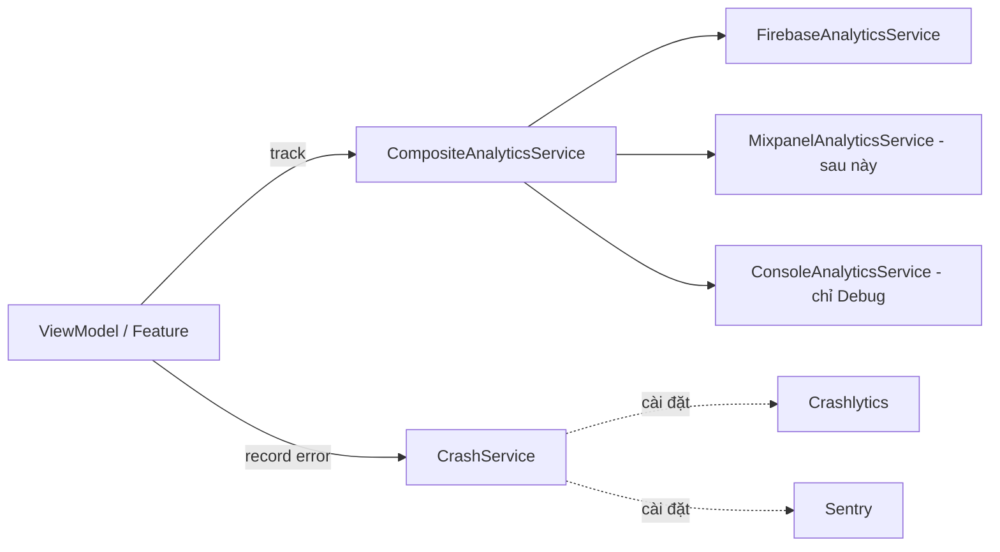

# TitanAnalytics

[← Về tổng quan](../README.md) · [Backend & adapter](Backend.md)

TitanAnalytics ghi sự kiện, thuộc tính người dùng và lỗi crash, rồi gửi tới một hoặc nhiều nhà cung cấp cùng lúc.

> Trạng thái: kit đã có `AnalyticsEvent`, `AnalyticsValue`, `AnalyticsService`, `CrashService`, `CompositeAnalyticsService`, `ConsoleAnalyticsService`, `NoOpAnalyticsService`, `SpyAnalyticsService`; adapter `FirebaseAnalyticsService` và `CrashlyticsService` trong `Adapters/TitanFirebase`. Dolingo bật/tắt thu thập ở Cài đặt → Dữ liệu & Phân tích.

## 1. Trách nhiệm

**Làm:**
- Định nghĩa `AnalyticsService` (sự kiện, màn hình, thuộc tính người dùng) và `CrashService` (crash, lỗi không gây crash, breadcrumb).
- Gửi một sự kiện tới nhiều nhà cung cấp qua `CompositeAnalyticsService`.
- Kiểm tra tên sự kiện theo quy ước, in log ra console ở bản Debug.
- Tôn trọng lựa chọn của người dùng: tắt thu thập khi họ từ chối.

**Không làm:**
- Không chứa danh sách sự kiện của từng app. Mỗi app tự khai báo sự kiện của mình.
- Không gửi dữ liệu cá nhân (email, tên, số điện thoại) làm tham số sự kiện.
- Không tự gọi khi mở màn hình. App hoặc TitanFeatures gọi rõ ràng.

## 2. Sơ đồ



## 3. API chính

```swift
public struct AnalyticsEvent: Sendable {
    public let name: String
    public let parameters: [String: AnalyticsValue]
    public init(_ name: String, _ parameters: [String: AnalyticsValue] = [:])
}

public enum AnalyticsValue: Sendable { case string(String), int(Int), double(Double), bool(Bool) }

public protocol AnalyticsService: Sendable {
    func track(_ event: AnalyticsEvent)
    func screen(_ name: String)
    func setUserId(_ id: String?)
    func setUserProperty(_ value: String?, for key: String)
    func setCollectionEnabled(_ enabled: Bool)
}

public protocol CrashService: Sendable {
    func record(_ error: Error, context: [String: String])
    func log(_ message: String)                 // breadcrumb
    func setUserId(_ id: String?)
    func setCollectionEnabled(_ enabled: Bool)
}
```

Composite chỉ là một vòng lặp:

```swift
public struct CompositeAnalyticsService: AnalyticsService {
    private let services: [AnalyticsService]
    public init(_ services: [AnalyticsService]) { self.services = services }
    public func track(_ event: AnalyticsEvent) { services.forEach { $0.track(event) } }
    // screen, setUserId, setUserProperty, setCollectionEnabled tương tự
}
```

### Quy ước đặt tên sự kiện

- `snake_case`, dạng `đối_tượng_hành_động`, động từ ở quá khứ: `paywall_viewed`, `purchase_completed`, `workout_started`.
- Tối đa 40 ký tự, chỉ chữ thường, số và `_` (giới hạn của Firebase).
- Tham số cũng `snake_case`, tối đa 25 tham số mỗi sự kiện.
- Sự kiện chung của kit có sẵn trong kit; sự kiện riêng app khai báo ở app:

```swift
public extension AnalyticsEvent {           // trong kit
    static func login(method: String) -> Self { .init("login_completed", ["method": .string(method)]) }
    static func paywallViewed(source: String) -> Self { .init("paywall_viewed", ["source": .string(source)]) }
    static let accountDeleted = AnalyticsEvent("account_deleted")
}
extension AnalyticsEvent {                  // trong App1
    static func workoutStarted(type: String) -> Self { .init("workout_started", ["type": .string(type)]) }
}
```

`ConsoleAnalyticsService` kiểm tra tên bằng regex `^[a-z][a-z0-9_]{0,39}$` và báo `assertionFailure` nếu sai, nên lỗi đặt tên lộ ra ngay khi chạy Debug.

### Thuộc tính người dùng

Đặt sau khi đăng nhập hoặc khi trạng thái đổi: `is_premium`, `app_language`, `theme`, `onboarding_variant`. Không dùng thuộc tính cho dữ liệu cá nhân.

## 4. Design pattern áp dụng và lý do

| Pattern | Lý do |
| --- | --- |
| Composite | Gửi một sự kiện tới nhiều nhà cung cấp, app chỉ gọi một lần |
| Adapter | Firebase, Mixpanel, Crashlytics, Sentry cắm vào cùng protocol |
| Null Object | `NoOpAnalyticsService` cho Preview và khi người dùng từ chối |
| Decorator | `ConsoleAnalyticsService` thêm log và kiểm tra tên mà không sửa adapter thật |

## 5. Cấu trúc thư mục

```
Packages/TitanKit/Sources/TitanAnalytics/
├── AnalyticsService.swift
├── CrashService.swift
├── AnalyticsEvent.swift
├── Events/CommonEvents.swift
├── CompositeAnalyticsService.swift
├── CompositeCrashService.swift
├── ConsoleAnalyticsService.swift
├── NoOpAnalyticsService.swift
└── Mock/{SpyAnalyticsService, SpyCrashService}.swift
Adapters/TitanFirebase/Sources/TitanFirebaseAnalytics/{FirebaseAnalyticsService, CrashlyticsService}.swift
Adapters/TitanSentry/               # tùy chọn
```

## 6. App sử dụng thế nào

```swift
// AppContainer.swift
var providers: [AnalyticsService] = [FirebaseAnalyticsService()]
#if DEBUG
providers.append(ConsoleAnalyticsService())
#endif
let analytics: AnalyticsService = CompositeAnalyticsService(providers)
let crash: CrashService = CrashlyticsService()
analytics.setCollectionEnabled(config.environment == .prod)
```

```swift
// Trong ViewModel
analytics.track(.workoutStarted(type: "hiit"))

do { try await repository.save(workout) }
catch { crash.record(error, context: ["screen": "workout_edit"]) }
```

Dev và Staging gửi vào Firebase project riêng của môi trường đó nên không làm bẩn số liệu Prod. Bật DebugView bằng launch argument `-FIRDebugEnabled` khi cần xem sự kiện thật.

## 7. Test

- `SpyAnalyticsService` lưu mọi sự kiện vào mảng `events`. Test ViewModel kiểm tra đúng tên và tham số đã gửi.
- `SpyCrashService` lưu lỗi đã ghi để kiểm tra luồng lỗi.
- Test `CompositeAnalyticsService`: một lần `track` đến đủ mọi provider.
- Test quy ước tên: duyệt mọi sự kiện khai báo trong app và kiểm tra regex.

## 8. Checklist cho App 1

- [ ] Liệt kê sự kiện chính của App 1 trong một file `App1Events.swift`
- [ ] Composite gồm Firebase + Console (Debug)
- [ ] Bật Crashlytics, thêm bước upload dSYM vào build (fastlane)
- [ ] Đặt `setUserId` sau đăng nhập, xóa khi đăng xuất
- [ ] Đặt thuộc tính `is_premium` theo `entitlementStream`
- [ ] Tắt thu thập khi người dùng từ chối trong Settings
- [ ] Kiểm tra không có dữ liệu cá nhân trong tham số sự kiện
- [ ] Khai báo dữ liệu thu thập trong privacy manifest
