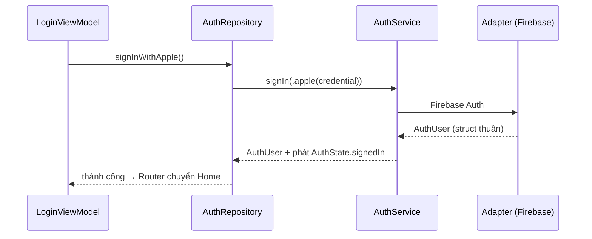

# TitanAuth

[← Về tổng quan](../README.md) · [Backend & adapter](Backend.md)

TitanAuth quản lý đăng nhập, đăng xuất, phiên đăng nhập và xóa tài khoản qua protocol `AuthService`, không phụ thuộc Firebase.

## 1. Trách nhiệm

**Làm:**
- Đăng nhập bằng email/mật khẩu, Sign in with Apple, Google.
- Phát trạng thái phiên (`AuthState`) để app biết đang đăng nhập hay chưa.
- Cấp ID token còn hạn cho TitanNetworking, tự làm mới khi sắp hết hạn.
- Xóa tài khoản (Apple bắt buộc nếu app có tạo tài khoản).

**Không làm:**
- Không vẽ màn hình đăng nhập (đó là `LoginScreen` trong TitanFeatures).
- Không lưu hồ sơ người dùng (tên, avatar, cài đặt). Việc đó thuộc `UserRepository` của app qua `DataService`.
- Không trả về kiểu `FirebaseAuth.User` ra ngoài adapter.

## 2. Sơ đồ



## 3. API chính

> Trạng thái: giai đoạn 3b đã có `AuthUser`, `AuthProvider`, `AuthState`, `SignInMethod`, `Credentials` (kiểm tra email, mật khẩu) và bản rút gọn của `AuthService` (`currentUser()`, `signIn`, `signUp`, `sendPasswordReset`, `signOut`, `deleteAccount`, ném `TitanError` có kiểu), cùng `MockAuthService`. `stateStream`, `idToken`, `reauthenticate` và adapter Firebase làm ở giai đoạn 4.

```swift
public struct AuthUser: Sendable, Equatable, Codable {
    public let id: String
    public let email: String?
    public let displayName: String?
    public let provider: AuthProvider
    public let isAnonymous: Bool
}

public enum AuthProvider: String, Sendable, Codable { case email, apple, google, anonymous }

public enum AuthState: Sendable, Equatable {
    case unknown          // đang kiểm tra lúc mở app
    case signedOut
    case signedIn(AuthUser)
}

public enum SignInMethod: Sendable {
    case email(email: String, password: String)
    case apple(idToken: String, rawNonce: String, fullName: PersonNameComponents?)
    case google(idToken: String, accessToken: String)
    case anonymous
}

/// Mọi hàm chỉ ném `TitanError` (ví dụ `.unauthorized`, `.network(.offline)`, `.cancelled`).
public protocol AuthService: Sendable {
    var currentUser: AuthUser? { get }
    var stateStream: AsyncStream<AuthState> { get }

    func signIn(_ method: SignInMethod) async throws -> AuthUser
    func signUp(email: String, password: String) async throws -> AuthUser
    func sendPasswordReset(email: String) async throws
    func signOut() async throws
    func idToken(forceRefresh: Bool) async throws -> String
    func reauthenticate(_ method: SignInMethod) async throws
    func deleteAccount() async throws
}
```

Phần lấy credential từ hệ thống nằm trong kit, không phụ thuộc backend:

```swift
@MainActor
public final class AppleSignInHelper {
    public func request() async throws -> SignInMethod  // trả về .apple(idToken:rawNonce:fullName:)
}
```

Google Sign-In cần SDK `GoogleSignIn`, nên `GoogleSignInHelper` nằm ở target riêng `TitanAuthGoogle`. App không dùng Google thì không kéo SDK này.

### Làm mới token

`idToken(forceRefresh: false)` trả token đang có nếu còn trên 5 phút, nếu không thì tự làm mới. TitanAuth có `AuthTokenProvider` cài đặt `TokenProvider` của [TitanNetworking](Networking.md):

```swift
public struct AuthTokenProvider: TokenProvider {
    let auth: AuthService
    public func accessToken() async -> String? { try? await auth.idToken(forceRefresh: false) }
    public func refreshToken() async throws -> String { try await auth.idToken(forceRefresh: true) }
}
```

`AuthInterceptor` gặp 401 thì gọi `refreshToken()` một lần rồi gửi lại. Vẫn 401 thì ném `.unauthorized`, `AuthRepository` bắt lỗi này và gọi `signOut()`.

### Xóa tài khoản

Apple yêu cầu cho xóa tài khoản ngay trong app. Luồng:
1. Màn Settings gọi `AuthRepository.deleteAccount()`.
2. Repository xóa dữ liệu của người dùng (`DataService`, `FileStorageService`) trước.
3. Gọi `AuthService.deleteAccount()`. Firebase báo cần đăng nhập gần đây thì adapter ném `.unauthorized`. Repository hỏi đăng nhập lại, gọi `reauthenticate`, rồi thử lại.
4. Với Apple, adapter thu hồi token Apple (revoke) trước khi xóa.
5. Phát `AuthState.signedOut`, Router về Onboarding.

## 4. Design pattern áp dụng và lý do

| Pattern | Lý do |
| --- | --- |
| Adapter | `FirebaseAuthService` hôm nay, `RESTAuthService` sau này, cùng một protocol |
| Observer (`AsyncStream`) | App và Router phản ứng ngay khi phiên thay đổi, không cần hỏi lại |
| Repository | `AuthRepository` của app gom đăng nhập + tạo hồ sơ + analytics vào một chỗ |
| Facade | Một API `signIn(_:)` che các luồng khác nhau của từng nhà cung cấp |

## 5. Cấu trúc thư mục

```
Packages/TitanKit/Sources/TitanAuth/
├── AuthService.swift
├── Models/{AuthUser, AuthState, SignInMethod}.swift
├── Apple/AppleSignInHelper.swift
├── AuthSession.swift            # ObservableObject bọc stateStream cho SwiftUI
├── AuthTokenProvider.swift      # nối với AuthInterceptor của TitanNetworking
└── Mock/MockAuthService.swift
Packages/TitanKit/Sources/TitanAuthGoogle/GoogleSignInHelper.swift
Adapters/TitanFirebase/Sources/TitanFirebaseAuth/FirebaseAuthService.swift
```

## 6. App sử dụng thế nào

```swift
// AppContainer.swift
let auth: AuthService = config.backend == .mock ? MockAuthService(signedIn: false)
                                                : FirebaseAuthService()
let authRepository = DefaultAuthRepository(auth: auth, users: userRepository,
                                           analytics: analytics)
```

```swift
// Apps/App1/Sources/Data/AuthRepository.swift
protocol AuthRepository: Sendable {
    func signInWithApple() async throws
    func deleteAccount() async throws
}

final class DefaultAuthRepository: AuthRepository {
    private let auth: AuthService
    private let users: UserRepository
    private let analytics: AnalyticsService

    init(auth: AuthService, users: UserRepository, analytics: AnalyticsService) {
        self.auth = auth; self.users = users; self.analytics = analytics
    }

    func signInWithApple() async throws {
        let method = try await AppleSignInHelper().request()
        let user = try await auth.signIn(method)
        try await users.createProfileIfNeeded(for: user)
        analytics.track(.login(method: "apple"))
    }

    func deleteAccount() async throws {
        guard let id = auth.currentUser?.id else { return }
        try await users.deleteAllData(userId: id)
        try await auth.deleteAccount()
        analytics.track(.accountDeleted)
    }
}
```

Root view lắng nghe phiên để đổi màn hình gốc:

```swift
@State private var authState: AuthState = .unknown
// body: switch authState { .unknown: SplashScreen, .signedOut: LoginScreen, .signedIn: MainTabView }
.task { for await state in container.auth.stateStream { authState = state } }
```

## 7. Test

- `MockAuthService`: giữ user trong bộ nhớ, cho phép đặt trước lỗi (`mock.nextError = .network(.offline)`) và phát `AuthState` bằng tay.
- Test `DefaultAuthRepository` với `MockAuthService` + `MockDataService`: đăng nhập tạo hồ sơ, xóa tài khoản xóa dữ liệu trước.
- Test `LoginViewModel`: lỗi `.cancelled` không hiện thông báo, lỗi `.network` hiện banner, lỗi `.unauthorized` khi xóa tài khoản thì hỏi đăng nhập lại.
- Contract test chung `AuthServiceContractTests` chạy với Firebase Auth Emulator.

## 8. Checklist cho App 1

- [ ] Bật Email, Apple, Google trong cả 3 Firebase project
- [ ] Thêm capability Sign in with Apple, cấu hình Services ID và key cho revoke token
- [ ] Thêm URL scheme của Google (`REVERSED_CLIENT_ID`) cho từng môi trường
- [ ] Viết `AuthRepository` của App 1, tạo hồ sơ sau lần đăng nhập đầu
- [ ] Nối `AuthInterceptor(tokens: AuthTokenProvider(auth:))` vào TitanNetworking
- [ ] Root view lắng nghe `stateStream` để chọn Home / Login
- [ ] Màn Settings có nút xóa tài khoản, xử lý đăng nhập lại khi cần
- [ ] Test xóa tài khoản trên máy thật với tài khoản Apple
