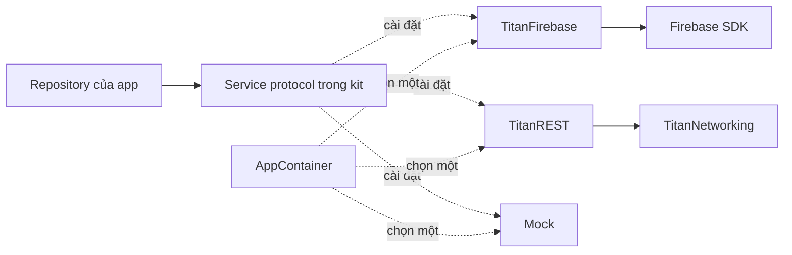

# Backend & Adapter

[← Về tổng quan](../README.md)

Kiến trúc adapter giúp app dùng Firebase hôm nay và đổi sang backend khác sau này mà không phải sửa màn hình hay Repository.

> Trạng thái: `Adapters/TitanFirebase` đã có các target `TitanFirebaseCore` (`FirebaseBootstrap`), `TitanFirebaseAuth` (`FirebaseAuthService`, `GoogleSignInHelper`), `TitanFirebaseAnalytics`, `TitanFirebaseRemoteConfig`, dùng Firebase 12.19.3 và GoogleSignIn 9.2.0; Tuist kéo vào qua `Tuist/Package.swift`. Cách bật cho Dolingo: [Firebase-Setup.md](../Firebase-Setup.md). `DataService` và `FileStorageService` chưa làm vì Dolingo chưa cần.

## 1. Trách nhiệm

**Làm:**
- Định nghĩa protocol cho từng dịch vụ backend trong kit.
- Cung cấp adapter cho từng nhà cung cấp: `TitanFirebase` (hiện tại), `TitanREST` (sau này), Mock (test và preview).
- Chuyển dữ liệu của SDK thành model Swift thuần và lỗi của SDK thành `TitanError`.

**Không làm:**
- Không chứa logic nghiệp vụ của app (việc đó thuộc Repository của app).
- Không để kiểu dữ liệu của SDK (`User` của Firebase, `DocumentSnapshot`, `Timestamp`...) lọt ra ngoài adapter.
- Không quyết định dùng adapter nào. Việc đó là của `AppContainer`.

## 2. Sơ đồ



## 3. API chính

Bảy protocol dịch vụ. Mỗi protocol nằm trong module của nó:

| Protocol | Module | Tài liệu |
| --- | --- | --- |
| `AuthService` | TitanAuth | [Auth.md](Auth.md) |
| `DataService` | TitanCore (thư mục `Backend/`) (đề xuất) | file này |
| `FileStorageService` | TitanCore (thư mục `Backend/`) (đề xuất) | file này |
| `AnalyticsService`, `CrashService` | TitanAnalytics | [Analytics.md](Analytics.md) |
| `RemoteConfigService` | TitanRemoteConfig | [RemoteConfig.md](RemoteConfig.md) |
| `PushService` | TitanPush | [Push.md](Push.md) |

`DataService` làm việc với collection và document dạng `Codable`, không biết Firestore:

```swift
public struct DataQuery: Sendable {
    public var filters: [Filter] = []
    public var orderBy: String?
    public var limit: Int?
    public enum Filter: Sendable { case equals(String, String), greaterThan(String, Double) }
}

/// Mọi hàm chỉ ném `TitanError`.
public protocol DataService: Sendable {
    func get<T: Decodable>(_ type: T.Type, path: String) async throws -> T?
    func list<T: Decodable>(_ type: T.Type, collection: String, query: DataQuery) async throws -> [T]
    func set<T: Encodable>(_ value: T, path: String) async throws
    func delete(path: String) async throws
    func observe<T: Decodable>(_ type: T.Type, path: String) -> AsyncStream<T?>
}

public protocol FileStorageService: Sendable {
    func upload(_ data: Data, path: String, contentType: String) async throws -> URL
    func download(path: String) async throws -> Data
    func delete(path: String) async throws
}
```

Adapter đổi lỗi SDK sang `TitanError` (định nghĩa ở [Core.md](Core.md)) tại một chỗ:

```swift
extension TitanError {
    static func fromFirestore(_ error: Error) -> TitanError {
        switch FirestoreErrorCode.Code(rawValue: (error as NSError).code) {
        case .unavailable: .network(.offline)
        case .permissionDenied, .unauthenticated: .unauthorized
        case .notFound: .notFound
        case .deadlineExceeded: .network(.timeout)
        default: .unknown(error.localizedDescription)
        }
    }
}
```

## 4. Hiện tại và sau này

| Protocol | Hiện tại (Firebase) | Có thể thay bằng |
| --- | --- | --- |
| `AuthService` | Firebase Auth | REST API riêng + JWT, Supabase Auth, Auth0 |
| `DataService` | Cloud Firestore | REST API riêng, Supabase (Postgres) |
| `FileStorageService` | Cloud Storage for Firebase | S3, Cloudflare R2, Supabase Storage |
| `AnalyticsService` | Firebase Analytics | Mixpanel, Amplitude, PostHog |
| `CrashService` | Crashlytics | Sentry |
| `RemoteConfigService` | Firebase Remote Config | API config riêng, Statsig |
| `PushService` | Firebase Cloud Messaging | APNs trực tiếp qua server riêng, OneSignal |

## 5. Design pattern áp dụng và lý do

| Pattern | Lý do |
| --- | --- |
| Adapter | Mỗi SDK được bọc sau một protocol chung, đổi SDK không sửa app |
| Dependency Injection | `AppContainer` chọn adapter theo môi trường, test thay bằng Mock |
| Repository (ở app) | App nói theo nghiệp vụ (`UserRepository`), không nói theo collection |
| Facade | Một protocol nhỏ che phần phức tạp của SDK (cache, listener, retry) |

## 6. Cấu trúc thư mục

```
Packages/TitanKit/Sources/TitanCore/Backend/
├── DataService.swift
├── DataQuery.swift
├── FileStorageService.swift
└── Mock/{MockDataService, MockFileStorageService}.swift
Adapters/TitanFirebase/              # package riêng, chỉ app import
├── Package.swift                    # mỗi dịch vụ một target
└── Sources/
    ├── TitanFirebaseCore/           # FirebaseApp.configure, map lỗi
    ├── TitanFirebaseAuth/
    ├── TitanFirebaseData/           # FirestoreDataService, FirebaseFileStorageService
    ├── TitanFirebaseAnalytics/      # Analytics + Crashlytics
    ├── TitanFirebaseRemoteConfig/
    └── TitanFirebasePush/
```

`TitanFirebase` tách khỏi `Packages/TitanKit` để kit build được mà không cần Firebase SDK. App chỉ thêm target Firebase nó cần.

## 7. App sử dụng thế nào

```swift
// Apps/App1/Sources/AppContainer.swift
import TitanCore
import TitanFirebaseData   // chỉ file này được import adapter

@MainActor
final class AppContainer: ObservableObject {
    let data: DataService
    let userRepository: UserRepository

    init(config: AppConfig) {
        switch config.backend {
        case .firebase: FirebaseBootstrap.configure(plist: config.firebasePlistName)
                        data = FirestoreDataService()
        case .mock:     data = MockDataService(seed: .sampleUsers)
        }
        userRepository = DefaultUserRepository(data: data)
    }
}
```

**Một Firebase project cho mỗi app, mỗi môi trường.** Ví dụ `app1-dev`, `app1-staging`, `app1-prod`. File `GoogleService-Info-Dev.plist`, `-Staging`, `-Prod` đặt trong `Apps/App1/Resources/Firebase/`, chọn theo xcconfig. Không dùng chung project giữa các app để dữ liệu, quota và quyền truy cập tách bạch.

### Quy tắc để luôn đổi được backend

1. Chỉ `AppContainer.swift` được `import Firebase*` hoặc `import TitanFirebase*`.
2. Model là `struct` Swift thuần, `Codable`. Không dùng `@DocumentID`, `Timestamp`, `GeoPoint`.
3. ID là `String`, ngày là `Date`. Adapter tự đổi kiểu.
4. Mọi lỗi ra khỏi adapter là `TitanError`.
5. Không gọi Cloud Functions trực tiếp. Gọi qua `TitanNetworking` bằng URL thường, để sau này trỏ sang server khác.
6. Không dựa vào tính năng chỉ Firestore có (query lồng phức tạp, offline persistence) trong logic nghiệp vụ.
7. Security Rules chỉ là lớp bảo vệ, không chứa logic mà app phụ thuộc.

### Đổi backend từng bước

1. Viết adapter mới (ví dụ `RESTDataService`) cài đặt cùng protocol.
2. Chạy bộ contract test chung của protocol cho adapter mới (xem mục Test).
3. Viết script chuyển dữ liệu từ Firebase sang backend mới.
4. Thêm case `.rest` vào `AppConfig.backend`, bật cho môi trường dev trước.
5. Đổi từng service một (Data trước, Auth sau cùng vì ảnh hưởng phiên đăng nhập).
6. Bật dần cho staging rồi prod. Giữ adapter cũ thêm một phiên bản để quay lại nếu cần.
7. Xóa adapter cũ và target Firebase không còn dùng.

## 8. Test

- Mỗi protocol có Mock trong thư mục `Mock/` của module: `MockDataService` lưu trong bộ nhớ, `MockFileStorageService` lưu vào dictionary.
- Repository của app được test bằng Mock, không cần mạng.
- **Contract test**: một bộ test chung (`DataServiceContractTests`) chạy với mọi adapter. Mock chạy trên CI mỗi PR; adapter Firebase chạy với Firebase Emulator trong job riêng.
- Test map lỗi: đưa mã lỗi SDK vào, kiểm tra ra đúng `TitanError`.

## 9. Checklist cho App 1

- [ ] Tạo 3 Firebase project: `app1-dev`, `app1-staging`, `app1-prod`
- [ ] Thêm 3 file `GoogleService-Info` và chọn theo xcconfig
- [ ] Chỉ `AppContainer.swift` import adapter Firebase
- [ ] Model của App 1 là struct `Codable` thuần, không có kiểu Firebase
- [ ] Repository của App 1 chỉ dùng `DataService` / `FileStorageService`
- [ ] Bật Firebase Emulator cho contract test trên CI
- [ ] Viết Security Rules cơ bản cho Firestore và Storage
- [ ] Có `.mock` backend để chạy Preview và UI test
