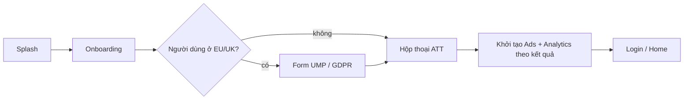

# Compliance: Privacy và App Store

[← Về tổng quan](../README.md)

## 1. Một câu tóm tắt

Tài liệu này liệt kê các yêu cầu bắt buộc của Apple và luật quyền riêng tư, chỉ ra phần nào kit đã lo và phần nào app phải tự làm, kèm checklist trước khi gửi review.

## 2. Trách nhiệm

| Yêu cầu | Kit lo | App phải làm |
| --- | --- | --- |
| Privacy manifest | `PrivacyInfo.xcprivacy` cho từng module kit | Manifest của app, khai báo dữ liệu thu thập trên App Store Connect |
| ATT | `TrackingConsent` hỏi quyền đúng thời điểm | Viết câu `NSUserTrackingUsageDescription` |
| UMP / GDPR | `ConsentManager` gọi Google UMP | Cấu hình form trên AdMob |
| Xóa tài khoản | `DeleteAccountScreen` + `AuthService.deleteAccount()` | Xóa dữ liệu của app trên backend |
| Sign in with Apple | Có sẵn trong `LoginScreen` | Bật capability, cấu hình Firebase |
| Thông tin gói thuê bao | `PaywallScreen` hiển thị đủ | Link Terms, Privacy thật |
| Khôi phục giao dịch | Nút Restore trong Paywall và Settings | — |

## 3. Sơ đồ

Thứ tự hỏi quyền khi mở app lần đầu:



Không khởi tạo SDK quảng cáo hay analytics có theo dõi trước khi có kết quả đồng ý.

## 4. API chính và cấu hình

### Privacy manifest

Mỗi target (app và từng module kit) có `PrivacyInfo.xcprivacy`. Ví dụ phần khai báo API cần lý do:

```xml
<key>NSPrivacyAccessedAPITypes</key>
<array>
  <dict>
    <key>NSPrivacyAccessedAPIType</key>
    <string>NSPrivacyAccessedAPICategoryUserDefaults</string>
    <key>NSPrivacyAccessedAPITypeReasons</key>
    <array><string>CA92.1</string></array>
  </dict>
</array>
<key>NSPrivacyTracking</key>
<false/>
```

Nếu app có quảng cáo cá nhân hóa thì `NSPrivacyTracking = true` và khai `NSPrivacyTrackingDomains`. SDK bên thứ ba (Firebase, AdMob) tự có manifest; cần dùng phiên bản SDK có manifest và chữ ký.

### ATT và UMP

```swift
public protocol ConsentManager: Sendable {
    func requestConsentIfNeeded() async -> ConsentStatus   // UMP, chỉ hiện khi cần
    func requestTracking() async -> TrackingStatus         // ATT
    func showPrivacyOptions() async                        // mở lại form từ Settings
}
```

`Info.plist` (qua `InfoPlist.xcstrings` để dịch):

```
NSUserTrackingUsageDescription = "Cho phép để thấy quảng cáo phù hợp hơn với bạn."
```

### Xóa tài khoản

Apple yêu cầu app có tạo tài khoản phải cho xóa tài khoản ngay trong app. `DeleteAccountScreen` nằm trong Settings, gọi `AuthService.deleteAccount()`, sau đó đăng xuất và xóa dữ liệu local. Nếu người dùng đăng nhập bằng Apple, kit thu hồi token Apple. Nếu có thuê bao đang chạy, màn hình nhắc người dùng hủy trong cài đặt Apple ID.

### Sign in with Apple

Nếu app có đăng nhập bằng Google, Facebook hay bên thứ ba khác thì phải có thêm Sign in with Apple (hoặc lựa chọn tương đương về quyền riêng tư). Cấu hình mặc định của `LoginConfig` đã đặt `.apple` lên đầu.

### Paywall

`PaywallScreen` luôn hiển thị: tên gói, giá và chu kỳ (`displayPrice` từ StoreKit), thời gian dùng thử và giá sau dùng thử, câu tự động gia hạn và cách hủy, link Terms of Use (EULA) và Privacy Policy, nút Restore Purchases. Không được làm mờ nút đóng hay giấu giá.

## 5. Cấu trúc thư mục

```
Packages/TitanKit/Sources/<Module>/Resources/PrivacyInfo.xcprivacy
Packages/TitanKit/Sources/TitanAds/ConsentManager.swift   (cài đặt UMP + ATT: Adapters/TitanAdMob/AdMobConsentManager.swift)
Packages/TitanKit/Sources/TitanFeatures/DeleteAccount/
Apps/App1/Resources/PrivacyInfo.xcprivacy
Apps/App1/Resources/InfoPlist.xcstrings
```

## 6. App sử dụng thế nào

1. Sửa `PrivacyInfo.xcprivacy` của app theo dữ liệu thật app thu thập.
2. Điền nhãn "App Privacy" trên App Store Connect khớp với manifest.
3. Gọi `consent.requestConsentIfNeeded()` rồi `requestTracking()` sau Onboarding, trước khi khởi tạo Ads.
4. Thêm mục "Quyền riêng tư" trong Settings gọi `showPrivacyOptions()`.
5. Bật Delete account và Restore trong `SettingsConfig`.
6. Chuẩn bị tài khoản demo cho người review nếu app bắt buộc đăng nhập.

## 7. Test

- Snapshot test Paywall để chắc đủ giá, chu kỳ, link và nút Restore.
- Unit test thứ tự: Ads chỉ khởi tạo sau khi có `ConsentStatus` và `TrackingStatus`.
- Test thủ công trên máy thật: xóa app, cài lại, kiểm tra ATT hiện đúng một lần.
- Dùng debug geography của UMP để giả lập người dùng EU.
- Test xóa tài khoản: đăng nhập lại bằng tài khoản cũ phải không còn dữ liệu.
- Xcode Organizer → "Generate Privacy Report" trên bản archive để xem manifest tổng hợp.

## 8. Checklist cho App 1 (trước khi gửi review)

- [ ] `PrivacyInfo.xcprivacy` của app đầy đủ, Privacy Report không báo thiếu lý do API.
- [ ] Nhãn App Privacy trên App Store Connect khớp manifest.
- [ ] Có Privacy Policy URL công khai, mở được trong app và trên App Store Connect.
- [ ] ATT chỉ hiện khi app thực sự theo dõi, có câu giải thích đã dịch.
- [ ] Form UMP hiện cho người dùng EU/UK, mở lại được từ Settings.
- [ ] Xóa tài khoản làm được ngay trong app, không phải gửi email.
- [ ] Có Sign in with Apple nếu có đăng nhập bên thứ ba.
- [ ] Paywall đủ giá, chu kỳ, dùng thử, tự gia hạn, Terms, Privacy.
- [ ] Nút Restore Purchases có trong Paywall và Settings.
- [ ] Tài khoản demo và ghi chú cho người review.
- [ ] Không còn màn hình, chữ hay link placeholder.
- [ ] App chạy được khi mất mạng (hiện màn hình Offline, không crash).
