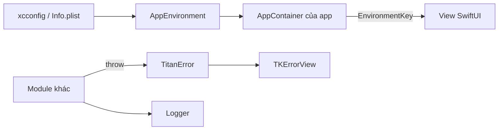

# TitanCore

[← Về tổng quan](../README.md)

## 1. Tóm tắt

TitanCore là nền móng chung của kit: extension, logger, kiểu lỗi thống nhất `TitanError`, khóa Environment cho DI và cấu hình môi trường dev/staging/prod.

## 2. Trách nhiệm

**Làm:**
- Cung cấp extension nhỏ, dùng ở nhiều nơi (`String`, `Date`, `Collection`, `View`).
- Ghi log qua `Logger` có mức độ (debug, info, warning, error).
- Định nghĩa `TitanError`, kiểu lỗi duy nhất mà mọi module trả ra ngoài.
- Định nghĩa `AppEnvironment` (dev, staging, prod) và cách đọc từ xcconfig.
- Cung cấp `EnvironmentKey` để đưa container và service xuống view.

**Không làm:**
- Không gọi network, không lưu dữ liệu, không vẽ UI.
- Không phụ thuộc module nào khác của kit, không phụ thuộc SDK bên ngoài.
- Không chứa logic nghiệp vụ của app.

## 3. Sơ đồ



## 4. API chính

```swift
// Lỗi thống nhất
public enum TitanError: Error, Equatable, Sendable {
    case network(NetworkReason)      // offline, timeout, server(code)
    case unauthorized
    case decoding(String)
    case notFound
    case storage(String)
    case cancelled
    case unknown(String)

    public var userMessage: String { /* chuỗi đã bản địa hóa */ "" }
    public var isRetryable: Bool { if case .network = self { return true }; return false }
}

public enum NetworkReason: Equatable, Sendable {
    case offline, timeout, server(statusCode: Int)
}

// Logger
public protocol Logging: Sendable {
    func log(_ level: LogLevel, _ message: @autoclosure () -> String,
             file: String, line: Int)
}
public enum LogLevel: Int, Comparable, Sendable { case debug, info, warning, error }

public struct OSLogger: Logging {
    public init(subsystem: String, minLevel: LogLevel) { }
}

// Môi trường
public enum AppEnvironment: String, Sendable {
    case dev, staging, prod
    public static var current: AppEnvironment {
        let raw = Bundle.main.object(forInfoDictionaryKey: "APP_ENV") as? String
        return AppEnvironment(rawValue: raw ?? "") ?? .dev
    }
    public var isProduction: Bool { self == .prod }
}

// DI qua Environment
public protocol DependencyContainer: AnyObject, Sendable { }

private struct ContainerKey: EnvironmentKey {
    static let defaultValue: (any DependencyContainer)? = nil
}
public extension EnvironmentValues {
    var container: (any DependencyContainer)? {
        get { self[ContainerKey.self] }
        set { self[ContainerKey.self] = newValue }
    }
}
```

## 5. Design pattern áp dụng và lý do

| Pattern | Ở đâu | Lý do |
| --- | --- | --- |
| Dependency Injection (Composition Root) | `DependencyContainer`, `EnvironmentKey` | App tạo mọi thứ ở `AppContainer`, view chỉ nhận qua Environment |
| Environment injection | `EnvironmentValues.container`, `.logger` | SwiftUI tự truyền xuống mọi view con |
| Strategy | `Logging` (OSLogger, ConsoleLogger, NoopLogger) | Đổi cách log theo môi trường, không sửa nơi gọi |
| Kiểu lỗi thống nhất | `TitanError` | UI chỉ cần xử lý một kiểu lỗi, dễ hiển thị và dễ test |

## 6. Cấu trúc thư mục

```
Sources/TitanCore/
├── Extensions/        # String+, Date+, Collection+, View+
├── Logging/           # Logging.swift, OSLogger.swift, LogLevel.swift
├── Error/             # TitanError.swift, NetworkReason.swift
├── Environment/       # AppEnvironment.swift
└── DI/                # DependencyContainer.swift, EnvironmentKeys.swift
Tests/TitanCoreTests/
```

## 7. App sử dụng thế nào

```swift
// Apps/App1/Sources/AppContainer.swift
@MainActor
final class AppContainer: DependencyContainer {
    let environment = AppEnvironment.current
    let logger: any Logging

    init() {
        logger = OSLogger(subsystem: "com.titan.app1",
                          minLevel: environment.isProduction ? .warning : .debug)
    }
}

// App1App.swift
@main
struct App1App: App {
    @State private var container = AppContainer()
    var body: some Scene {
        WindowGroup {
            RootView()
                .environment(\.container, container)
        }
    }
}

// Trong ViewModel
do { try await repo.load() }
catch let error as TitanError { state = .failed(error) }
```

`APP_ENV` được đặt trong `Config/{Dev,Staging,Prod}.xcconfig` và khai báo trong Info.plist.

## 8. Test

- Test `TitanError.isRetryable` và `userMessage` cho từng case.
- Test `AppEnvironment` đọc đúng giá trị từ một `Bundle` giả.
- Mock có sẵn: `MockLogger` lưu các dòng log vào mảng để kiểm tra.

```swift
func testRetryableOnlyForNetwork() {
    XCTAssertTrue(TitanError.network(.timeout).isRetryable)
    XCTAssertFalse(TitanError.unauthorized.isRetryable)
}
```

## 9. Checklist cho App 1

- [ ] Thêm `APP_ENV` vào 3 file xcconfig và Info.plist
- [ ] Tạo `AppContainer` tuân theo `DependencyContainer`
- [ ] Inject container qua `.environment(\.container, ...)` ở root
- [ ] Chọn logger: debug cho dev/staging, warning cho prod
- [ ] Mọi Repository chuyển lỗi về `TitanError` trước khi trả lên ViewModel
- [ ] Không thêm extension riêng của app vào TitanCore
