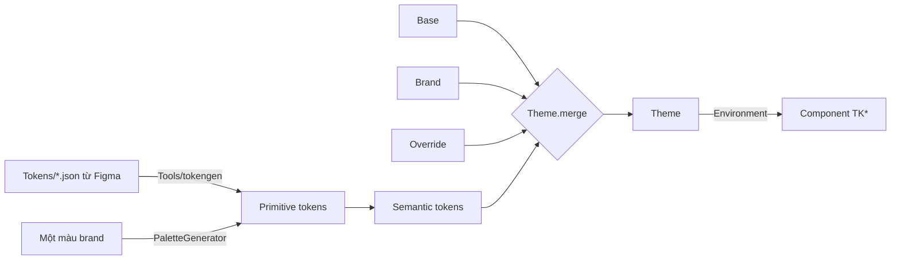

# TitanDesignSystem

[← Về tổng quan](../README.md)

## 1. Tóm tắt

TitanDesignSystem cung cấp token, theme 3 lớp và bộ component `TK*` để mọi app có giao diện nhất quán, đổi thương hiệu chỉ bằng cấu hình.

## 2. Trách nhiệm

**Làm:**
- Định nghĩa token primitive (giá trị thô) và token semantic (ý nghĩa sử dụng).
- Hợp nhất theme 3 lớp: base của kit, brand của app, override từ Figma.
- Sinh bảng màu đầy đủ từ một màu thương hiệu.
- Typography theo vai trò, spacing, bo góc, hỗ trợ dark mode và Dynamic Type.
- Component dùng chung: `TKButton`, `TKTextField`, `TKCard`, `TKNavBar`, `TKSheet`, `TKToast`, `TKEmptyState`, `TKErrorView`, `TKLoading`, `TKAsyncContent`.
- Script trong `Tools/` sinh code Swift từ JSON token Figma; app `Catalog` để xem trước.

**Không làm:**
- Không chứa màn hình nghiệp vụ (đó là TitanFeatures).
- Không điều hướng (đó là TitanNavigation).
- Component không dùng mã màu hay cỡ chữ trực tiếp, chỉ dùng token semantic.

## 3. Sơ đồ



## 4. API chính

```swift
// Primitive: giá trị thô, không mang ý nghĩa
public struct ColorScale: Sendable { public let shades: [Int: Color] } // 50...900

// Semantic: dùng trong component
public struct ColorTokens: Sendable {
    public var actionPrimary: Color      // color.action.primary
    public var actionOnPrimary: Color
    public var surfaceBackground: Color
    public var surfaceCard: Color
    public var textPrimary: Color
    public var textSecondary: Color
    public var feedbackError: Color
    public var feedbackSuccess: Color
}

public enum TextRole: CaseIterable, Sendable { case display, title, headline, body, caption }
public struct Typography: Sendable {
    public var fontFamily: String?                 // nil = font hệ thống
    public func font(_ role: TextRole) -> Font { /* dùng Font.custom(relativeTo:) */ .body }
}

public enum Spacing: CGFloat, Sendable { case xs = 4, sm = 8, md = 16, lg = 24, xl = 32 }

public struct Theme: Sendable {
    public var colors: ColorTokens        // mỗi Color có biến thể light/dark
    public var typography: Typography
    public var radius: Radius             // sm, md, lg
    public var logo: Image?

    public static let base: Theme
    public func merged(with patch: ThemePatch) -> Theme   // lớp sau thắng lớp trước
}

public struct ThemePatch: Sendable {      // mọi field optional
    public var colors: ColorTokensPatch?
    public var fontFamily: String?
    public var radius: Radius?
    public var logo: Image?
}

public enum PaletteGenerator {
    /// Sinh ColorTokens light + dark từ một màu brand (thang 50...900 theo HSL)
    public static func tokens(from brand: Color) -> ColorTokens
}

public extension EnvironmentValues { var theme: Theme { get set } }
public extension View { func titanTheme(_ theme: Theme) -> some View }

// Component mẫu
public struct TKButton: View {
    public enum Style { case primary, secondary, ghost, destructive }
    public init(_ title: LocalizedStringKey, style: Style = .primary,
                isLoading: Bool = false, action: @escaping () -> Void) { }
}
public struct TKErrorView: View {
    public init(error: TitanError, retry: (() -> Void)? = nil) { }
}
public extension View {
    func tkToast(_ message: Binding<TKToast.Message?>) -> some View
    func tkSheet<Content: View>(isPresented: Binding<Bool>,
                                @ViewBuilder content: () -> Content) -> some View
}
```

Danh sách component:

| Component | Dùng cho |
| --- | --- |
| `TKButton` | Nút chính, phụ, ghost, hủy; có trạng thái loading |
| `TKTextField` | Ô nhập có label, lỗi, icon, secure |
| `TKCard` | Khối nội dung có nền, bo góc, bóng |
| `TKNavBar` | Thanh tiêu đề tùy biến |
| `TKSheet` | Bottom sheet theo theme |
| `TKToast` | Thông báo ngắn tự ẩn |
| `TKEmptyState` | Màn hình trống: icon, tiêu đề, nút hành động |
| `TKErrorView` | Hiển thị `TitanError`, có nút thử lại (dùng cho offline) |
| `TKLoading` | Spinner và skeleton |
| `TKAsyncContent` | Bọc nội dung theo trạng thái loading / loaded / empty / error, tự hiện TKLoading, TKEmptyState, TKErrorView |

## 5. Design pattern áp dụng và lý do

| Pattern | Ở đâu | Lý do |
| --- | --- | --- |
| Strategy | `Theme` | Đổi giao diện cả app bằng cách đổi một giá trị, không sửa component |
| Environment injection | `\.theme` | Mọi component tự đọc theme, không truyền tay |
| Token 2 tầng (primitive → semantic) | `ColorScale` → `ColorTokens` | Đổi màu thương hiệu không phải sửa từng chỗ dùng |
| Merge 3 lớp | `Theme.merged(with:)` | Không có design vẫn chạy với base, có design chỉ ghi đè phần cần |
| Code generation | `Tools/tokengen` | Token Figma và code luôn khớp, không gõ tay |

## 6. Cấu trúc thư mục

```
Sources/TitanDesignSystem/
├── Tokens/
│   ├── Primitive/       # ColorScale, Generated/PrimitiveTokens.swift (sinh tự động)
│   └── Semantic/        # ColorTokens, Typography, Spacing, Radius
├── Theme/               # Theme.swift, ThemePatch.swift, Theme+Environment.swift
├── Palette/             # PaletteGenerator.swift
├── Components/          # TKButton, TKTextField, TKCard, TKNavBar, TKSheet,
│                        # TKToast, TKEmptyState, TKErrorView, TKLoading
└── Resources/           # Asset catalog, font mặc định
Tests/TitanDesignSystemTests/   # unit + snapshot test
Tokens/                         # JSON token export từ Figma (gốc repo)
Tools/tokengen/                 # script JSON → Swift
Catalog/                        # app xem trước component và theme
```

## 7. App sử dụng thế nào

```swift
// Apps/App1/Theme/App1Theme.swift
enum App1Theme {
    static let brand = ThemePatch(
        colors: .init(from: PaletteGenerator.tokens(from: Color(hex: 0x3B5BFD))),
        fontFamily: "Inter",
        radius: .rounded,
        logo: Image("Logo")
    )
    static let override = ThemePatch.fromGenerated(App1Tokens.self) // nếu có Figma riêng
    static let theme = Theme.base.merged(with: brand).merged(with: override)
}

// AppContainer.swift
let theme = App1Theme.theme

// App1App.swift
RootView().titanTheme(container.theme)

// Trong màn hình
TKButton("Tiếp tục", isLoading: vm.isLoading) { Task { await vm.submit() } }
    .padding(.horizontal, Spacing.md.rawValue)
Text("Xin chào").font(theme.typography.font(.title))
```

Quy trình Figma: designer xuất JSON vào `Tokens/App1/` → chạy `Tools/tokengen` → file Swift sinh ra trong `Apps/App1/Theme/Generated/` → commit.

## 8. Test

- Unit test `Theme.merged(with:)`: lớp sau thắng, field nil giữ nguyên.
- Unit test `PaletteGenerator`: độ tương phản chữ trên nền đạt WCAG AA.
- Snapshot test mỗi component ở light, dark và Dynamic Type lớn (`.accessibility3`).
- `Theme.preview` dùng cho SwiftUI Preview; Catalog hiển thị mọi component với theme của từng app.

## 9. Checklist cho App 1

- [ ] Chọn màu brand và sinh bảng màu bằng `PaletteGenerator`
- [ ] Tạo `App1Theme` với lớp brand (font, bo góc, logo)
- [ ] Nếu có Figma riêng: xuất JSON vào `Tokens/App1/` và chạy `Tools/tokengen`
- [ ] Gắn `.titanTheme(...)` ở root view
- [ ] Kiểm tra mọi màn hình ở dark mode và Dynamic Type lớn
- [ ] Không dùng mã màu hay cỡ chữ trực tiếp trong màn hình của app
- [ ] Mở Catalog với theme App 1 để duyệt cùng designer
