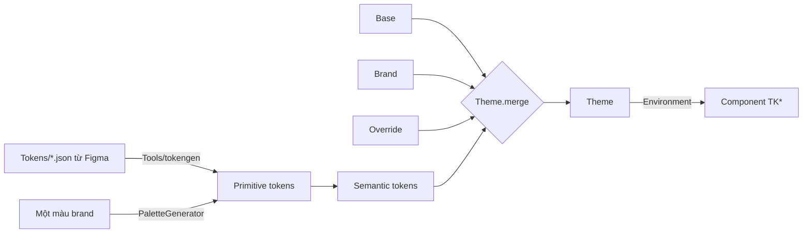

# TitanDesignSystem

[← Về tổng quan](../README.md)

## 1. Tóm tắt

TitanDesignSystem cung cấp token, theme 3 lớp và bộ component `TK*` để mọi app có giao diện nhất quán, đổi thương hiệu chỉ bằng cấu hình.

## 2. Trách nhiệm

**Làm:**
- Định nghĩa token primitive (giá trị thô) và token semantic (ý nghĩa sử dụng).
- Hợp nhất theme 3 lớp: base của kit, brand của app, override từ Figma.
- Sinh bảng màu đầy đủ từ một màu thương hiệu.
- Typography theo vai trò, spacing, bo góc, hỗ trợ dark mode và Dynamic Type.
- Component dùng chung: `TKButton`, `TKTextField`, `TKCard`, `TKNavBar`, `TKSheet`, `TKToast`, `TKAlert`, `TKModal`, `TKAvatar`, `TKEmptyState`, `TKErrorView`, `TKLoading`, `TKAsyncContent`.
- Script trong `Tools/` sinh code Swift từ JSON token Figma; app `Catalog` để xem trước.

**Không làm:**
- Không chứa màn hình nghiệp vụ (đó là TitanFeatures).
- Không điều hướng (đó là TitanNavigation).
- Component không dùng mã màu hay cỡ chữ trực tiếp, chỉ dùng token semantic.

## 3. Sơ đồ



## 4. API chính

> Trạng thái: giai đoạn 2a xong phần token và theme (code thật bên dưới). Component `TK*` làm ở giai đoạn 2b.

```swift
// Primitive: giá trị thô, không mang ý nghĩa
public struct RGBA: Hashable, Sendable {            // màu thô, tính được độ tương phản
    public init(hex: UInt32, alpha: Double = 1)
    public func contrast(with other: RGBA) -> Double  // tỉ lệ WCAG, 1...21
    public var readableForeground: RGBA               // trắng hoặc đen, cái nào dễ đọc hơn
}
public struct AdaptiveColor: Hashable, Sendable {   // một màu cho sáng, một màu cho tối
    public init(light: RGBA, dark: RGBA)
    public init(_ both: RGBA)
    public var color: Color                           // tự đổi theo dark mode
}
public struct ColorScale: Hashable, Sendable {      // 10 bậc 50...900
    public init(_ hexes: [UInt32])                    // dán thẳng từ trang Colors của Figma
    public subscript(step: Int) -> RGBA
}

// Semantic: component chỉ dùng tầng này
public struct ColorTokens: Hashable, Sendable {
    // action: primary, onPrimary, secondary, onSecondary, disabled, onDisabled
    // surface: background, card, input, border
    // text: primary, secondary, disabled
    // feedback: success, warning, error, info
}
public struct ColorTokensPatch { /* cùng các field, tất cả optional */ }

public enum TextRole { case display, title1, title2, title3, headline, body, callout, caption }
public struct TextStyle { size, weight, lineHeight /* 1.4 = 140% */, tracking }
public struct Typography {
    public var fontFamily: String?                    // nil = font hệ thống
    public var localizedFontFamilies: [String: String] // ["vi": TKFonts.plusJakartaSans]
    public func font(_ role: TextRole) -> Font        // co giãn theo Dynamic Type
}
public enum TKFonts {                                 // font nhúng sẵn trong kit (OFL)
    static let urbanist, plusJakartaSans              // 400, 500, 600, 700
}

public enum Spacing { xxs 4, xs 8, sm 12, md 16, lg 24, xl 32, xxl 48 }
public struct Radius { sm, md, lg; static .sharp, .rounded, .soft, full }

public struct Theme: Hashable, Sendable {
    public var colors: ColorTokens
    public var typography: Typography
    public var radius: Radius
    public var gradientPrimary: TKGradient          // mặc định: màu thương hiệu nhạt dần
    public var logoName: String?
    public static let base: Theme
    public func merged(with patch: ThemePatch) -> Theme   // lớp sau thắng lớp trước
}
public struct ThemePatch { colors?, fontFamily?, localizedFontFamilies?, textStyles?, radius?, gradientPrimary?, logoName? }

public struct TKGradient { stops, start, end; init(from: RGBA, to: RGBA); var linearGradient }
public enum TKPalette {
    enum Gradients { blue, purple, green, orange, red, teal, brown, yellow }   // Figma "Gradients"
    enum Tints { blue, purple, green, orange, red, teal, brown, yellow, grey } // Figma "Background"
}

public enum PaletteGenerator {
    public static func scale(from brand: RGBA) -> ColorScale     // 1 màu → 10 bậc
    public static func tokens(from brand: RGBA) -> ColorTokens   // 1 màu → đủ màu sáng + tối
}

public extension EnvironmentValues { var theme: Theme }
public extension View {
    func titanTheme(_ theme: Theme) -> some View      // gắn 1 lần ở gốc
    func tkTextStyle(_ role: TextRole) -> some View   // font + giãn dòng + giãn chữ
}
```

Font: kit nhúng sẵn Urbanist và Plus Jakarta Sans (giấy phép OFL, file trong `Resources/Fonts`). `.titanTheme(...)` tự đăng ký font, app không phải khai báo gì trong Info.plist. Urbanist thiếu chữ đ, ơ, ư và dấu chồng của tiếng Việt, nên khi máy để tiếng Việt, theme đổi sang font trong `localizedFontFamilies`. Vì theme đọc ngôn ngữ từ môi trường, gắn `.titanTheme(...)` bên trong `LocalizedRoot`.

Component (giai đoạn 2b). Kích thước và trạng thái lấy từ trang Button và Input Form của Figma.

```swift
// Nút: 7 kiểu, 4 cỡ (65 / 58 / 50 / 43), 2 dáng
TKButton("Tiếp tục", style: .primary, size: .large, isLoading: vm.isSaving) { ... }
TKButton("Bỏ qua", style: .light, leadingIcon: Image(tk: .buy)) { ... }
TKIconButton(Image(tk: .plus), accessibilityLabel: "Thêm") { ... }
RootView().tkButtonShape(.pill)          // đổi dáng mặc định cho cả app

// Ô nhập: thường, mật khẩu, nhiều dòng; trạng thái lỗi / hợp lệ
TKTextField("Email", text: $email, prompt: "john@domain.com",
            icon: Image(tk: .message), status: .error("Email không hợp lệ"))
TKTextField("Mật khẩu", text: $password, kind: .secure)

// Khối nội dung, thông báo, trạng thái
TKCard { ... }
.tkToast($toast)                          // toast = TKToast("Đã lưu", style: .success)
TKAsyncContent(vm.state, retry: vm.reload) { items in ... }   // tự hiện loading / lỗi / rỗng
TKCatalogView()                           // xem mọi token và component với theme hiện tại

// Chọn (theo trang Checkbox, Radio, Toggle, Chips, Tag, Dropdown của Figma)
Toggle("Nhớ đăng nhập", isOn: $remember).toggleStyle(.tkCheckbox)
Toggle("Âm thanh", isOn: $sound).toggleStyle(.tkSwitch)          // hoặc .tkSwitch(.line)
TKRadioGroup(selection: $level, options: [TKOption(.beginner, title: "Mới bắt đầu"), ...])
TKChip("Ngữ pháp", isSelected: filter == .grammar) { filter = .grammar }
TKTag("Mới", tone: .info)                                        // style: .solid / .soft / .outline / .plain
TKDropdown("Trình độ", selection: $level, options: levels)       // Set<Value> thì chọn nhiều

// Điều hướng (theo trang Navbar, Menu Bar, Horizontal Tab, Search của Figma)
LessonList().tkNavigationBar("Bài học", onBack: { router.pop() }) {
    TKNavBarButton(Image(tk: .notification), accessibilityLabel: "Thông báo") { ... }
}
QuizScreen().tkNavigationBar(progress: vm.progress, onBack: { router.pop() })
content.safeAreaInset(edge: .bottom, spacing: 0) {
    TKTabBar(selected: tabs.selected, items: items) { tabs.select($0) }   // nối thẳng với TabRouter
}
TKUnderlineTabs(selection: $section, options: sections)          // tab gạch chân
TKSegmentedTabs(selection: $period, options: periods)            // tab dạng khối
TKSearchField(text: $query) { vm.search() }

// Cảnh báo, hộp thoại, thông báo (theo trang Alert, Modal, Notification của Figma)
TKAlert("Mật khẩu chưa đúng", status: .error)                   // .info / .success / .warning / .error
root.tkModal(isPresented: $showDone) {                           // gắn vào gốc màn hình để che cả thanh trên
    TKModal("Chúc mừng!", message: "Bạn đã xong bài học.",
            primary: TKModalAction("Tiếp tục") { showDone = false }) {
        TKSuccessIllustration(.confetti)
    }
}
screen.tkSheet(isPresented: $choosing) {                         // bottom sheet cao vừa nội dung
    TKSheet(title: Text("Chọn chủ đề"), primary: .init("OK") { apply() },
            secondary: .init("Huỷ") { choosing = false }) {
        TKRadioGroup(selection: $draft, options: options)
    }
}
RootView().tkAppearance(appearance)                              // .system / .light / .dark
TKNotificationRow("Bài học mới", message: "Unit 3 đã mở", time: "2 giờ trước",
                  leading: .icon(.tickSquare), isUnread: true) { open(item) }

// Hiển thị (theo trang Avatar, Divider của Figma)
TKAvatar(image: user.photo, name: user.name, badge: .online)   // không có ảnh thì hiện chữ cái đầu
TKDivider("hoặc tiếp tục với")

// Lịch, tiến độ, chat, danh mục (theo trang Calendar, Date & Progress, Goals Percentage, Message, Category Menu)
TKCalendar(selection: $day)                                      // tuần bắt đầu theo \.calendar, tên tháng theo \.locale
TKCalendar(selection: $day) { vm.goalProgress(on: $0) }          // vòng tiến độ quanh từng ngày
TKWeekStrip(selection: $day) { vm.goalProgress(on: $0) }         // một tuần, ngày chọn có khung
TKPeriodHeader(title: Text(vm.rangeTitle), onPrevious: vm.previous, onNext: vm.canGoNext ? vm.next : nil)
TKProgressRing(0.3) { Text("30") }
TKMessageBubble(message.text, time: message.time, direction: .outgoing, status: .read)
TKCategoryItem("Ngữ pháp", icon: Image(tk: .document, style: .bold)) { open(.grammar) }

// Màn Cài đặt và Paywall (theo trang Settings Elements, Account List, Select Country, Subscriptions Card)
TKUpgradeBanner(title: Text("Nâng cấp ngay!"), message: Text("Mở khoá mọi bài học")) { showPaywall() }
TKListRow(user.name, subtitle: user.email) { TKAvatar(image: user.photo, size: 60) } trailing: { ... }
TKSettingsRow("Tuỳ chọn", icon: Image(tk: .setting)) { router.push(.preferences) }
TKSettingsRow("Nhắc học hằng ngày", accessory: .toggle($remind))   // .chevron, .value, .toggle, .checkmark, .none
TKSettingsRow("Đăng xuất", icon: Image(tk: .logout), role: .destructive, accessory: .none) { logOut() }
TKOptionCard("Việt Nam", isSelected: country == .vn) { flag } action: { country = .vn }
TKPlanCard(title: Text("Premium"), price: Text(product.displayPrice), period: Text("/ tháng"),
           benefits: benefits, badge: Text("Phổ biến nhất"), actionTitle: Text("Chọn gói")) { buy(product) }
content.tkOutlinedCard(isSelected: isPicked)                    // viền 2 pt, cạnh dưới dày, viền tím khi chọn
```

| Kiểu nút | Trông thế nào |
| --- | --- |
| `primary` | Nền màu thương hiệu, chữ trắng |
| `light` | Nền tím nhạt, chữ màu thương hiệu |
| `neutral` | Nền xám đậm, chữ trắng |
| `outline` | Chỉ có viền màu thương hiệu |
| `bordered` | Nền thẻ, viền xám (kiểu "Continue with Apple") |
| `elevated` | Như primary, thêm bóng |
| `threeD` | Như primary, có cạnh dưới đậm, bấm thì lún xuống |

Danh sách component:

| Component | Dùng cho |
| --- | --- |
| `TKButton`, `TKIconButton` | 7 kiểu, 4 cỡ, bo góc hoặc viên thuốc; có trạng thái loading và disabled |
| `TKTextField` | Ô nhập có label, icon, mật khẩu, nhiều dòng, trạng thái lỗi / hợp lệ |
| `TKCard` | Khối nội dung có nền, bo góc, bóng |
| Checkbox, Switch | `Toggle` với `.toggleStyle(.tkCheckbox)`, `.tkSwitch`, `.tkSwitch(.line)` |
| `TKRadio`, `TKRadioGroup` | Chọn một trong nhiều mục |
| `TKChip` | Bộ lọc, lựa chọn dạng viên thuốc; 3 kiểu (filled, outline, neutral), 3 cỡ (34 / 42 / 49) |
| `TKTag` | Nhãn nhỏ không bấm được; 5 sắc thái (neutral, info, success, warning, error), 4 kiểu, 3 cỡ |
| `TKDropdown` | Ô chọn mở danh sách ngay bên dưới; chọn một (radio) hoặc nhiều (checkbox) |
| `TKOption` | Một lựa chọn (giá trị, chữ, icon) dùng chung cho radio, chip, dropdown |
| `TKNavBar`, `.tkNavigationBar` | Thanh trên: nút quay lại, tiêu đề lớn hoặc thanh tiến độ, tối đa 3 nút icon; ẩn thanh hệ thống |
| `TKProgressBar` | Thanh tiến độ bo tròn 12 pt |
| `TKTabBar`, `TKTabItem` | Thanh tab dưới; icon light khi thường, bold khi chọn; bấm lại tab đang chọn vẫn gọi `onSelect` để quay về màn đầu |
| `TKUnderlineTabs` | Tab ngang có gạch chân trượt theo tab chọn |
| `TKSegmentedTabs` | Tab dạng khối, tab chọn tô màu thương hiệu |
| `TKSearchField` | Ô tìm kiếm có nút xoá, đổi màu khi đang gõ |
| `TKAlert` | Dòng cảnh báo trên nền nhạt của màu trạng thái; 4 trạng thái, icon riêng cho từng loại |
| `TKModal`, `.tkModal` | Hộp thoại giữa màn hình: hình minh hoạ, tiêu đề, mô tả, tối đa 2 nút hoặc spinner; nền tối phía sau |
| `TKSuccessIllustration` | Vòng tròn màu thương hiệu có dấu tick, kiểu đơn hoặc có chấm confetti |
| `TKNotificationRow` | Một dòng thông báo: ảnh hoặc icon, tiêu đề, mô tả, thời gian, chấm chưa đọc, mũi tên |
| `TKAvatar` | Ảnh đại diện tròn; không có ảnh thì hiện chữ cái đầu; huy hiệu online, offline, sửa, LIVE |
| `TKDivider` | Đường kẻ 1 pt màu viền, có thể có chữ ở giữa |
| `TKCalendar` | Lịch tháng có mũi tên đổi tháng; chọn ngày; có thể vẽ vòng tiến độ mục tiêu quanh mỗi ngày |
| `TKWeekStrip` | Dải 7 ngày của tuần đang chọn, kèm vòng tiến độ; dùng làm bản thu gọn của lịch |
| `TKPeriodHeader` | Tiêu đề khoảng thời gian có mũi tên trước / sau; ghép với `TKSegmentedTabs` cho Tuần / Tháng / Năm |
| `TKProgressRing` | Vòng tiến độ 42 pt chạy theo chiều kim đồng hồ từ đỉnh, có thể có chữ ở giữa |
| `TKMessageBubble` | Bong bóng chat: tin đến màu xám bên trái (có tên người gửi), tin đi màu thương hiệu bên phải (có dấu đã gửi / đã đọc) |
| `TKCategoryItem` | Icon tròn nền nhạt kèm nhãn, dùng cho lưới danh mục |
| `TKSettingsRow` | Một dòng cài đặt: icon, tiêu đề, cuối dòng là mũi tên, giá trị, công tắc hoặc dấu tick; kiểu đỏ cho Đăng xuất |
| `TKListRow` | Dòng danh sách tài khoản: avatar, tên đậm, dòng phụ xám, bất kỳ view nào ở cuối |
| `TKOptionCard` | Thẻ có viền để chọn quốc gia, tài khoản liên kết, phương thức thanh toán; viền tím và dấu tick khi chọn |
| `TKPlanCard` | Thẻ gói trả phí: giá, chu kỳ, danh sách quyền lợi, huy hiệu góc, nút chọn hoặc "Gói hiện tại của bạn" |
| `TKUpgradeBanner` | Băng rôn tím "Nâng cấp ngay" ở đầu màn Cài đặt |
| `.tkOutlinedCard` | Kiểu thẻ có viền dùng chung cho các thẻ trên |
| `TKSheet`, `.tkSheet` | Bottom sheet cao vừa nội dung: tiêu đề giữa, nội dung giữa hai đường kẻ, nút Huỷ và OK cạnh nhau |
| `TKAppearance`, `.tkAppearance` | Lựa chọn Sáng / Tối / Theo hệ thống; app lưu lại và gắn ở gốc |
| `TKToast` | Thông báo ngắn tự ẩn |
| `TKEmptyState` | Màn hình trống: icon, tiêu đề, nút hành động |
| `TKErrorView` | Hiển thị `TitanError`, có nút thử lại (dùng cho offline) |
| `TKLoadingView`, `.tkSkeleton` | Spinner và khung xám nhấp nháy khi đang tải |
| `TKAsyncContent` | Bọc nội dung theo trạng thái loading / loaded / empty / error, tự hiện TKLoading, TKEmptyState, TKErrorView |

## 5. Design pattern áp dụng và lý do

| Pattern | Ở đâu | Lý do |
| --- | --- | --- |
| Strategy | `Theme` | Đổi giao diện cả app bằng cách đổi một giá trị, không sửa component |
| Environment injection | `\.theme` | Mọi component tự đọc theme, không truyền tay |
| Token 2 tầng (primitive → semantic) | `ColorScale` → `ColorTokens` | Đổi màu thương hiệu không phải sửa từng chỗ dùng |
| Merge 3 lớp | `Theme.merged(with:)` | Không có design vẫn chạy với base, có design chỉ ghi đè phần cần |
| Code generation | `Tools/tokengen` | Token Figma và code luôn khớp, không gõ tay |

## 6. Cấu trúc thư mục

```
Sources/TitanDesignSystem/
├── Tokens/
│   ├── Primitive/       # ColorScale, Generated/PrimitiveTokens.swift (sinh tự động)
│   └── Semantic/        # ColorTokens, Typography, Spacing, Radius
├── Theme/               # Theme.swift, ThemePatch.swift, Theme+Environment.swift
├── Palette/             # PaletteGenerator.swift
├── Components/          # TKButton, TKTextField, TKCard, TKNavBar, TKSheet,
│                        # TKToast, TKEmptyState, TKErrorView, TKLoading
└── Resources/           # Asset catalog, font mặc định
Tests/TitanDesignSystemTests/   # unit + snapshot test
Tokens/                         # JSON token export từ Figma (gốc repo)
Tools/tokengen/                 # script JSON → Swift
Catalog/                        # app xem trước component và theme
```

## 7. App sử dụng thế nào

Ví dụ thật: `Apps/Dolingo/Sources/Theme/DolingoTheme.swift`.

```swift
// Cách 1: app chưa có design, chỉ có một màu thương hiệu
let theme = Theme.base.merged(with: ThemePatch(
    colors: ColorTokensPatch(PaletteGenerator.tokens(from: RGBA(hex: 0xFF6B00))),
    radius: .soft
))

// Cách 2: app có Figma (như Dolingo): chỉ ghi đè những gì khác base
enum DolingoTheme {
    static let primary = ColorScale([0xEEEEFF, /* ... */ 0x5150FF])
    static let brand: ThemePatch = {
        var colors = ColorTokensPatch()
        colors.actionPrimary = AdaptiveColor(primary[900])
        colors.surfaceBackground = AdaptiveColor(light: .white, dark: RGBA(hex: 0x181A20))
        // ...
        return ThemePatch(colors: colors, fontFamily: TKFonts.urbanist,
                          localizedFontFamilies: ["vi": TKFonts.plusJakartaSans],
                          textStyles: [.display: TextStyle(size: 48, weight: .bold)],
                          radius: .soft,
                          gradientPrimary: TKGradient(from: primary[900], to: primary[700]))
    }()
    static let theme = Theme.base.merged(with: brand)
}

// DolingoApp.swift: gắn một lần ở gốc, bên trong LocalizedRoot
LocalizedRoot(...) { RootView().titanTheme(DolingoTheme.theme) }

// Trong màn hình
@Environment(\.theme) private var theme
RoundedRectangle(cornerRadius: theme.radius.md).fill(theme.gradientPrimary.linearGradient)
Text("Xin chào")
    .tkTextStyle(.display)
    .foregroundStyle(theme.colors.textPrimary.color)
    .padding(Spacing.md)
```

Khi Figma đổi màu: sửa số hex trong file theme của app, không đụng component. Script `Tools/tokengen` (sinh code tự động từ JSON Figma) để sau, vì tài khoản Figma hiện là bản free và chép tay 1 lần là đủ.

## 8. Test

- Unit test `Theme.merged(with:)`: lớp sau thắng, field nil giữ nguyên.
- Unit test font: mọi độ đậm của hai font đăng ký được; tiếng Việt đổi font, ngôn ngữ khác giữ Urbanist.
- Unit test component chọn: màu switch, chip, tag theo từng kiểu; chọn nhiều bật / tắt đúng.
- Unit test điều hướng: thanh tiến độ giới hạn trong 0...1; chữ "Tìm kiếm", "Xoá" có đủ hai ngôn ngữ.
- Unit test cảnh báo và avatar: màu từng trạng thái trên nền 8%; chữ cái đầu của tên tiếng Việt.
- Unit test lịch: lưới tháng 12/2024 bắt đầu Chủ nhật hoặc thứ Hai đúng như Figma; tuần chứa một ngày; tên thứ theo ngày đầu tuần; vòng tiến độ giới hạn 0...1; chữ "Trước", "Sau" có đủ hai ngôn ngữ.
- Unit test thẻ có viền: viền 2 pt, 3 pt khi chọn, cạnh dưới đủ 5 pt như Figma; chữ "Gói hiện tại của bạn" có đủ hai ngôn ngữ.
- Unit test giao diện: `TKAppearance` ra đúng `ColorScheme` và được lưu bằng tên.
- Unit test gradient: theme base bắt đầu từ màu thương hiệu, patch thay được gradient.
- Unit test `PaletteGenerator`: độ tương phản chữ trên nền đạt WCAG AA.
- Snapshot test mỗi component ở light, dark và Dynamic Type lớn (`.accessibility3`).
- Đã làm: `Packages/TitanKit/Tests/TitanSnapshotTests` (swift-snapshot-testing 1.17.6) chụp nút, ô nhập, thẻ gói, tab, ô mã, dòng cài đặt, trạng thái rỗng ở light và dark, rộng 360 pt, scale 2, theme base, và một ảnh cỡ chữ `.accessibility3`. `ScreenSnapshotTests` chụp các màn dựng sẵn của TitanFeatures ở 390 × 844, tiếng Việt. Ảnh gốc ở `__Snapshots__`; CI (job TitanKit tests) so sánh với độ khớp 99 % (cảm nhận 98 %). Helper dùng chung ở `SnapshotSupport.swift`. Ảnh cỡ chữ lớn chụp với font Urbanist (như Dolingo), vì font hệ thống của theme base phóng theo cài đặt của máy chứ không theo `dynamicTypeSize` của view; ảnh đó cho thấy `TKButton` xuống tối đa 2 dòng và tự cao lên, còn ô nhập giữ một dòng.
- Ghi ảnh gốc: PR có sửa design system hay snapshot test thì workflow **Snapshots** tự chụp các ảnh còn thiếu, kiểm tra test qua, rồi commit vào branch của PR; ảnh đã có mà khác đi vẫn làm job TitanKit tests đỏ. Đổi giao diện có chủ ý: Actions → **Snapshots** → Run workflow trên branch đó để chụp lại toàn bộ (chỉ chạy được khi workflow đã có trên `main`). Mở commit ảnh xem trước khi merge. Trên máy Mac: `Tools/snapshots.sh record`.
- `Theme.preview` dùng cho SwiftUI Preview; Catalog hiển thị mọi component với theme của từng app.

## 9. Checklist cho App 1

- [x] Lấy bảng màu Primary, Secondary, Greyscale, Dark, Alert từ Figma
- [x] Tạo `DolingoTheme` với lớp brand (màu, font Urbanist, cỡ chữ, bo góc)
- [x] Gắn `.titanTheme(...)` ở root view
- [x] Nhúng font Urbanist, tiếng Việt dùng Plus Jakarta Sans
- [x] Gradient, màu nền nhạt theo trang Colors của Figma
- [x] Nút và ô nhập theo trang Button, Input Form của Figma
- [x] Checkbox, Radio, Switch, Chips, Tag, Dropdown theo Figma
- [ ] Số điện thoại, ô mã PIN: làm cùng màn hình đăng nhập ở giai đoạn 3
- [ ] Kiểm tra mọi màn hình ở dark mode và Dynamic Type lớn
- [ ] Không dùng mã màu hay cỡ chữ trực tiếp trong màn hình của app
- [ ] Mở Catalog với theme App 1 để duyệt cùng designer
