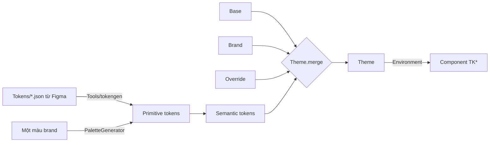

# TitanDesignSystem

[← Về tổng quan](../README.md)

## 1. Tóm tắt

TitanDesignSystem cung cấp token, theme 3 lớp và bộ component `TK*` để mọi app có giao diện nhất quán, đổi thương hiệu chỉ bằng cấu hình.

## 2. Trách nhiệm

**Làm:**
- Định nghĩa token primitive (giá trị thô) và token semantic (ý nghĩa sử dụng).
- Hợp nhất theme 3 lớp: base của kit, brand của app, override từ Figma.
- Sinh bảng màu đầy đủ từ một màu thương hiệu.
- Typography theo vai trò, spacing, bo góc, hỗ trợ dark mode và Dynamic Type.
- Component dùng chung: `TKButton`, `TKTextField`, `TKCard`, `TKNavBar`, `TKSheet`, `TKToast`, `TKEmptyState`, `TKErrorView`, `TKLoading`, `TKAsyncContent`.
- Script trong `Tools/` sinh code Swift từ JSON token Figma; app `Catalog` để xem trước.

**Không làm:**
- Không chứa màn hình nghiệp vụ (đó là TitanFeatures).
- Không điều hướng (đó là TitanNavigation).
- Component không dùng mã màu hay cỡ chữ trực tiếp, chỉ dùng token semantic.

## 3. Sơ đồ



## 4. API chính

> Trạng thái: giai đoạn 2a xong phần token và theme (code thật bên dưới). Component `TK*` làm ở giai đoạn 2b.

```swift
// Primitive: giá trị thô, không mang ý nghĩa
public struct RGBA: Hashable, Sendable {            // màu thô, tính được độ tương phản
    public init(hex: UInt32, alpha: Double = 1)
    public func contrast(with other: RGBA) -> Double  // tỉ lệ WCAG, 1...21
    public var readableForeground: RGBA               // trắng hoặc đen, cái nào dễ đọc hơn
}
public struct AdaptiveColor: Hashable, Sendable {   // một màu cho sáng, một màu cho tối
    public init(light: RGBA, dark: RGBA)
    public init(_ both: RGBA)
    public var color: Color                           // tự đổi theo dark mode
}
public struct ColorScale: Hashable, Sendable {      // 10 bậc 50...900
    public init(_ hexes: [UInt32])                    // dán thẳng từ trang Colors của Figma
    public subscript(step: Int) -> RGBA
}

// Semantic: component chỉ dùng tầng này
public struct ColorTokens: Hashable, Sendable {
    // action: primary, onPrimary, secondary, onSecondary, disabled, onDisabled
    // surface: background, card, input, border
    // text: primary, secondary, disabled
    // feedback: success, warning, error, info
}
public struct ColorTokensPatch { /* cùng các field, tất cả optional */ }

public enum TextRole { case display, title1, title2, title3, headline, body, callout, caption }
public struct TextStyle { size, weight, lineHeight /* 1.4 = 140% */, tracking }
public struct Typography {
    public var fontFamily: String?                    // nil = font hệ thống
    public func font(_ role: TextRole) -> Font        // co giãn theo Dynamic Type
}

public enum Spacing { xxs 4, xs 8, sm 12, md 16, lg 24, xl 32, xxl 48 }
public struct Radius { sm, md, lg; static .sharp, .rounded, .soft, full }

public struct Theme: Hashable, Sendable {
    public var colors: ColorTokens
    public var typography: Typography
    public var radius: Radius
    public var logoName: String?
    public static let base: Theme
    public func merged(with patch: ThemePatch) -> Theme   // lớp sau thắng lớp trước
}
public struct ThemePatch { colors?, fontFamily?, textStyles?, radius?, logoName? }

public enum PaletteGenerator {
    public static func scale(from brand: RGBA) -> ColorScale     // 1 màu → 10 bậc
    public static func tokens(from brand: RGBA) -> ColorTokens   // 1 màu → đủ màu sáng + tối
}

public extension EnvironmentValues { var theme: Theme }
public extension View {
    func titanTheme(_ theme: Theme) -> some View      // gắn 1 lần ở gốc
    func tkTextStyle(_ role: TextRole) -> some View   // font + giãn dòng + giãn chữ
}
```

Component dự kiến (giai đoạn 2b), kích thước nút lấy từ Figma: Large 65, Medium 58, Small 50, Extra Small 43; dáng bo góc hoặc viên thuốc (pill).

```swift
public struct TKButton: View {
    public enum Style { case primary, light, outline, bordered, elevated }
    public init(_ title: LocalizedStringKey, style: Style = .primary,
                isLoading: Bool = false, action: @escaping () -> Void)
}
public struct TKErrorView: View {
    public init(error: TitanError, retry: (() -> Void)? = nil)
}
```

Danh sách component:

| Component | Dùng cho |
| --- | --- |
| `TKButton` | Nút chính, phụ, ghost, hủy; có trạng thái loading |
| `TKTextField` | Ô nhập có label, lỗi, icon, secure |
| `TKCard` | Khối nội dung có nền, bo góc, bóng |
| `TKNavBar` | Thanh tiêu đề tùy biến |
| `TKSheet` | Bottom sheet theo theme |
| `TKToast` | Thông báo ngắn tự ẩn |
| `TKEmptyState` | Màn hình trống: icon, tiêu đề, nút hành động |
| `TKErrorView` | Hiển thị `TitanError`, có nút thử lại (dùng cho offline) |
| `TKLoading` | Spinner và skeleton |
| `TKAsyncContent` | Bọc nội dung theo trạng thái loading / loaded / empty / error, tự hiện TKLoading, TKEmptyState, TKErrorView |

## 5. Design pattern áp dụng và lý do

| Pattern | Ở đâu | Lý do |
| --- | --- | --- |
| Strategy | `Theme` | Đổi giao diện cả app bằng cách đổi một giá trị, không sửa component |
| Environment injection | `\.theme` | Mọi component tự đọc theme, không truyền tay |
| Token 2 tầng (primitive → semantic) | `ColorScale` → `ColorTokens` | Đổi màu thương hiệu không phải sửa từng chỗ dùng |
| Merge 3 lớp | `Theme.merged(with:)` | Không có design vẫn chạy với base, có design chỉ ghi đè phần cần |
| Code generation | `Tools/tokengen` | Token Figma và code luôn khớp, không gõ tay |

## 6. Cấu trúc thư mục

```
Sources/TitanDesignSystem/
├── Tokens/
│   ├── Primitive/       # ColorScale, Generated/PrimitiveTokens.swift (sinh tự động)
│   └── Semantic/        # ColorTokens, Typography, Spacing, Radius
├── Theme/               # Theme.swift, ThemePatch.swift, Theme+Environment.swift
├── Palette/             # PaletteGenerator.swift
├── Components/          # TKButton, TKTextField, TKCard, TKNavBar, TKSheet,
│                        # TKToast, TKEmptyState, TKErrorView, TKLoading
└── Resources/           # Asset catalog, font mặc định
Tests/TitanDesignSystemTests/   # unit + snapshot test
Tokens/                         # JSON token export từ Figma (gốc repo)
Tools/tokengen/                 # script JSON → Swift
Catalog/                        # app xem trước component và theme
```

## 7. App sử dụng thế nào

Ví dụ thật: `Apps/Dolingo/Sources/Theme/DolingoTheme.swift`.

```swift
// Cách 1: app chưa có design, chỉ có một màu thương hiệu
let theme = Theme.base.merged(with: ThemePatch(
    colors: ColorTokensPatch(PaletteGenerator.tokens(from: RGBA(hex: 0xFF6B00))),
    radius: .soft
))

// Cách 2: app có Figma (như Dolingo): chỉ ghi đè những gì khác base
enum DolingoTheme {
    static let primary = ColorScale([0xEEEEFF, /* ... */ 0x5150FF])
    static let brand: ThemePatch = {
        var colors = ColorTokensPatch()
        colors.actionPrimary = AdaptiveColor(primary[900])
        colors.surfaceBackground = AdaptiveColor(light: .white, dark: RGBA(hex: 0x181A20))
        // ...
        return ThemePatch(colors: colors, fontFamily: "Urbanist",
                          textStyles: [.display: TextStyle(size: 48, weight: .bold)],
                          radius: .soft)
    }()
    static let theme = Theme.base.merged(with: brand)
}

// DolingoApp.swift: gắn một lần ở gốc
RootView().titanTheme(DolingoTheme.theme)

// Trong màn hình
@Environment(\.theme) private var theme
Text("Xin chào")
    .tkTextStyle(.display)
    .foregroundStyle(theme.colors.textPrimary.color)
    .padding(Spacing.md)
```

Khi Figma đổi màu: sửa số hex trong file theme của app, không đụng component. Script `Tools/tokengen` (sinh code tự động từ JSON Figma) để sau, vì tài khoản Figma hiện là bản free và chép tay 1 lần là đủ.

## 8. Test

- Unit test `Theme.merged(with:)`: lớp sau thắng, field nil giữ nguyên.
- Unit test `PaletteGenerator`: độ tương phản chữ trên nền đạt WCAG AA.
- Snapshot test mỗi component ở light, dark và Dynamic Type lớn (`.accessibility3`).
- `Theme.preview` dùng cho SwiftUI Preview; Catalog hiển thị mọi component với theme của từng app.

## 9. Checklist cho App 1

- [x] Lấy bảng màu Primary, Secondary, Greyscale, Dark, Alert từ Figma
- [x] Tạo `DolingoTheme` với lớp brand (màu, font Urbanist, cỡ chữ, bo góc)
- [x] Gắn `.titanTheme(...)` ở root view
- [ ] Nhúng file font Urbanist vào app (hiện đang dùng font hệ thống thay thế)
- [ ] Đối chiếu màu từng màn với ảnh Figma khi làm component
- [ ] Kiểm tra mọi màn hình ở dark mode và Dynamic Type lớn
- [ ] Không dùng mã màu hay cỡ chữ trực tiếp trong màn hình của app
- [ ] Mở Catalog với theme App 1 để duyệt cùng designer
