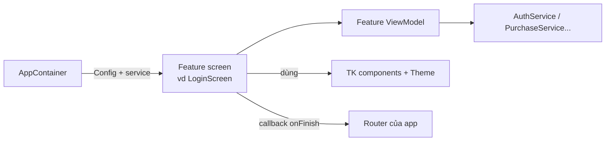

# TitanFeatures

[← Về tổng quan](../README.md)

## 1. Một câu tóm tắt

TitanFeatures là bộ màn hình dựng sẵn (Splash, Onboarding, Login, Paywall, Settings...) mà app chỉ cần cấu hình bằng một struct `Config` và vài callback, giao diện tự theo theme của app.

## 2. Trách nhiệm

- Cung cấp các màn hình chung mà app nào cũng cần, đã xử lý loading, lỗi, mất mạng.
- Mỗi màn hình nhận `Config` (nội dung, tùy chọn) và callback (việc xảy ra khi người dùng làm gì).
- Chỉ dùng component `TK*` và token của [DesignSystem.md](DesignSystem.md), nên đổi theme là đổi giao diện.
- Gọi dịch vụ qua protocol (`AuthService`, `PurchaseService`...), không biết Firebase.
- Không tự điều hướng: báo kết quả qua callback để app hoặc Router quyết định đi đâu.

## 3. Sơ đồ



## 4. API chính

Mọi màn hình theo cùng một dạng:

```swift
public struct LoginConfig: Sendable {
    public var methods: [LoginMethod] = [.apple, .google, .email]
    public var logo: ImageResource?
    public var termsURL: URL
    public var privacyURL: URL
    public var allowsGuest: Bool = false
}

public struct LoginScreen: View {
    public init(
        config: LoginConfig,
        auth: any AuthService,
        onSuccess: @escaping (User) -> Void,
        onSkip: (() -> Void)? = nil
    )
}
```

Danh sách màn hình:

| Màn hình | Config chính | Callback chính | Dịch vụ dùng |
| --- | --- | --- | --- |
| `SplashScreen` | logo, thời gian tối thiểu | `onResult(LaunchStatus)` | RemoteConfig |
| `OnboardingScreen` | danh sách trang (ảnh, tiêu đề, mô tả) | `onFinish` | — |
| `LoginScreen` | phương thức đăng nhập, link điều khoản | `onSuccess(User)`, `onSkip` | Auth |
| `PaywallScreen` | product ID, lợi ích, kiểu bố cục | `onPurchased`, `onClose` | Purchase |
| `SettingsScreen` | danh sách mục, header tuỳ chọn | `onLogout`, `onSelect(id)` | — |
| `AppearanceScreen` | binding chủ đề, `LocalizationService` | `onBack` | Localization |
| `ProfileScreen` | trường cho phép sửa | `onSaved` | Auth |
| `DeleteAccountScreen` | lý do, cảnh báo | `onDeleted` | Auth |
| `RateAppPrompt` | số lần mở app / sự kiện trước khi hỏi | — | Storage |
| `WebPageScreen` | URL, tiêu đề (Terms, Privacy) | `onBack` | — |
| `MaintenanceScreen` | thông điệp | `onRetry` | RemoteConfig |
| `ForceUpdateScreen` | link App Store | — | — |
| `StateView` | `.offline`, `.error(Error)`, `.empty(EmptyConfig)` | `onRetry` | — |

`StateView` dùng được trong màn hình riêng của app:

```swift
TKAsyncContent(state: viewModel.state) { items in
    ItemList(items: items)
} empty: {
    StateView(.empty(EmptyConfig(title: "list.empty.title", icon: .tray)))
}
```

## 5. Design pattern áp dụng và lý do

| Pattern | Dùng ở đâu | Lý do |
| --- | --- | --- |
| MVVM | Mỗi màn hình có ViewModel riêng | Test logic không cần giao diện |
| Strategy (Config) | `LoginConfig`, `PaywallConfig`... | Đổi hành vi bằng dữ liệu, không sửa code |
| Callback / Delegate | `onSuccess`, `onFinish` | Màn hình không biết luồng của app |
| Template Method (slot) | `header`, `footer` ViewBuilder tùy chọn | Thay một phần màn hình mà không viết lại |
| Dependency Injection | Service truyền qua `init` | Dùng Mock trong preview và test |

## 6. Cấu trúc thư mục

```
Packages/TitanKit/Sources/TitanFeatures/
├── Splash/{SplashScreen, SplashViewModel, SplashConfig}.swift
├── Onboarding/
├── Login/
├── Paywall/
├── Settings/
├── Profile/
├── DeleteAccount/
├── RateApp/
├── WebPage/
├── Maintenance/
├── ForceUpdate/
└── States/{StateView, EmptyConfig}.swift
```

Mỗi thư mục có `Screen`, `ViewModel`, `Config` và có thể có view con. Chuỗi hiển thị nằm trong `TitanKit.xcstrings` (xem [Localization.md](Localization.md)).

## 7. App sử dụng thế nào

Có 3 mức tùy biến, đi từ dễ đến khó:

1. **Cấu hình**: chỉ truyền `Config` khác. Đủ cho phần lớn trường hợp.

```swift
case .login:
    LoginScreen(
        config: .init(methods: [.apple, .email], termsURL: AppConfig.termsURL, privacyURL: AppConfig.privacyURL),
        auth: container.auth,
        onSuccess: { _ in router.replaceRoot(.home) }
    )
```

2. **Theme và slot**: giao diện tự đổi theo theme của app. Muốn thêm ảnh minh họa hay khối riêng thì dùng slot `header` / `footer`.
3. **Thay thế**: viết màn hình riêng trong `Apps/App1/Sources/Features/Login/` và gắn vào cùng `Route`. Vẫn dùng lại `AuthService`, nên logic đăng nhập không phải viết lại. Chỉ chọn cách này khi design khác hẳn bố cục của kit.

Quy tắc: nếu cần sửa màn hình kit cho một app, hãy thêm tùy chọn vào `Config` thay vì rẽ nhánh theo tên app.

## 8. Test

- Unit test ViewModel của mỗi màn hình với service Mock: thành công, lỗi, hủy, mất mạng.
- Snapshot test mỗi màn hình với base theme, theme tối và một brand theme mẫu, ở `vi` và `en`.
- Mỗi màn hình có trang trong Catalog để xem nhanh các trạng thái.
- Test riêng `RateAppPrompt`: chỉ hỏi khi đủ điều kiện và không hỏi lại quá giới hạn.

## 8b. Đã làm (giai đoạn 3b, đợt 1)

Bố cục theo các màn "1 splash", "2 welcome", "21 sign in" trong Figma Dolingo.

```swift
SplashScreen(config: SplashConfig(logo: Image("Logo"), appName: "Dolingo"),
             prepare: { await flow.prepareLaunch() },      // chạy song song với thời gian tối thiểu
             onFinish: { flow.finishSplash() })

OnboardingScreen(config: OnboardingConfig(pages: [OnboardingPage(image:, title:, message:)]),
                 onGetStarted: { ... }, onSignIn: { ... })

LoginScreen(config: LoginConfig(socialOptions: [SocialLoginOption(.apple, icon: Image(systemName: "apple.logo"), accessibilityLabel: "Apple")]),
            auth: container.auth,
            onSuccess: { user in ... }, onSocial: { provider in ... },
            onForgotPassword: { ... }, onSignUp: { ... })
```

- Ô nhập ở màn đăng nhập dùng kiểu gạch chân (`.tkFieldStyle(.underlined)`), giống Figma.
- Logo Google, Facebook không đi kèm kit (bản quyền thương hiệu): app tự đưa ảnh vào `SocialLoginOption`.
- Ảnh của Dolingo nằm trong `Apps/Dolingo/Resources/Assets.xcassets`: logo gốc từ Figma (`Logo`, `LogoCircle`, `LogoText` có bản cho dark mode), icon app vẽ từ logo gốc, ảnh Welcome và logo Google, Apple, Facebook. File Figma hiện là bản mẫu, các màn hình chỉ là ảnh phẳng 430×932, nên ảnh Welcome đang được cắt từ đó và hơi mờ. Có file gốc thì thay ảnh này.
- Trước giai đoạn 4, ba nút mạng xã hội của Dolingo đăng nhập dạng khách (`AppFlow.signInWithSocial`) để thử được trọn luồng.
- Đăng nhập Apple, Google thật làm ở giai đoạn 4 cùng adapter Firebase. Hiện Dolingo dùng `MockAuthService` (tài khoản thử `demo@titan.app` / `123456`).
- Chưa làm: quên mật khẩu, nhập mã OTP, đăng ký.

## 8c. Đã làm (giai đoạn 3b, đợt 2)

Bố cục theo các màn "86 account & settings", "104 app appearance", "105 theme", "110 privacy policy" và "112 logout" trong Figma Dolingo.

```swift
SettingsScreen(sections: [
    SettingsSection(items: [
        SettingsItem("appearance", title: Text.kit(KitStrings.Settings.appearance, locale: locale), icon: Image(tk: .show)),
        SettingsItem("privacy", title: Text.kit(KitStrings.Settings.privacy, locale: locale), icon: Image(tk: .shieldDone)),
    ]),
], onBack: { router.pop() },
   onSelect: { id in router.push(route(for: id)) },
   onLogout: { await flow.signOut() }) {
    TKUpgradeBanner(title: Text("Nâng cấp ngay!")) { router.present(.paywall) }   // header tuỳ chọn
}

AppearanceScreen(appearance: $appearance, localization: container.localization, onBack: { router.pop() })

WebPageScreen(title: Text.kit(KitStrings.Settings.privacy, locale: locale), url: AppConfig.privacyURL,
              onBack: { router.pop() })
```

- `SettingsScreen` không tự điều hướng: mỗi dòng có một id, app nhận id qua `onSelect` rồi tự chọn màn. Dòng Đăng xuất màu đỏ nằm cuối thẻ cuối, bấm vào hiện bottom sheet hỏi lại.
- Slot `header` dùng cho băng rôn nâng cấp và thẻ hồ sơ. Dolingo gắn băng rôn nâng cấp (ẩn khi đã có premium), chưa gắn thẻ hồ sơ.
- `AppearanceScreen` có hai dòng Chủ đề và Ngôn ngữ ứng dụng, mỗi dòng mở một bottom sheet chọn bằng radio. Chủ đề lưu trong `Preferences` của app (`DolingoKeys.appearance`) và gắn ở gốc bằng `.tkAppearance`; ngôn ngữ đổi qua `LocalizationService`.
- `WebPageScreen` mở trang web trong app; đang tải thì hiện spinner, lỗi thì hiện `TKErrorView` có nút thử lại (mất mạng ra lỗi offline).
- Link Privacy Policy và Terms của Dolingo đang là chỗ giữ (`example.com`) trong `AppConfig`, thay khi có trang thật.
- Dolingo: màn Home tạm có nút "Cài đặt"; deep link `dolingo://settings` mở thẳng màn này.

## 8d. Đã làm (giai đoạn 3b, đợt 3)

```swift
switch flow.stage {
case .maintenance(let message):
    MaintenanceScreen(message: message) { await flow.retryLaunch() }   // nút Thử lại
case .forceUpdate(let storeURL):
    ForceUpdateScreen(storeURL: storeURL)                               // nút Cập nhật ngay mở App Store
...
}
```

- Hai màn chặn dùng chung một bố cục: hình trong vòng tròn màu nhạt, tiêu đề, mô tả, một nút ở dưới. App có thể đưa hình riêng qua `illustration`. Figma Dolingo không có hai màn này nên bố cục theo các màn trống khác của kit.
- Thông điệp bảo trì lấy từ remote config (`maintenance_message`); để trống thì dùng câu của kit.
- Màn cập nhật không có đường vượt qua: chỉ có nút mở App Store.
- Dolingo: `AppFlow.prepareLaunch()` chạy `LaunchChecker` trước khi chọn màn đầu; `retryLaunch()` kiểm tra lại và cho vào app khi hết bảo trì. Link App Store đang là chỗ giữ trong `AppConfig.appStoreURL`.

## 8e. Đã làm (giai đoạn 3b, đợt 4)

```swift
ProfileScreen(auth: container.auth, onBack: { router.pop() },
              onDeleteAccount: { router.push(.deleteAccount) })

DeleteAccountScreen(auth: container.auth, onBack: { router.pop() }) {
    flow.didDeleteAccount()          // tài khoản đã xoá trên backend, về màn đăng nhập
}
```

- `ProfileScreen`: avatar chữ cái đầu, ô Họ và tên sửa được, email chỉ đọc, nút Lưu chỉ bật khi tên đổi và không để trống. Lưu gọi `AuthService.updateProfile(displayName:)` (hàm mới của protocol). Dưới cùng có dòng đỏ "Xoá tài khoản" nếu app truyền `onDeleteAccount`.
- `DeleteAccountScreen`: cảnh báo không khôi phục được, danh sách những gì sẽ mất (app thay bằng `consequences`), ô tick xác nhận, nút đỏ, rồi bottom sheet hỏi lại lần cuối. Backend báo cần đăng nhập lại (`.unauthorized`) thì hiện lời nhắc đăng nhập lại.
- Đây là màn xoá tài khoản ngay trong app mà App Review yêu cầu với app có đăng ký tài khoản.
- Figma Dolingo có màn "93 personal info" và "97 account & security", nhưng lần này chưa đọc được vì tài khoản Figma đã hết lượt gọi của gói Starter. Bố cục đang theo các màn khác của kit; khi đọc được Figma sẽ chỉnh lại.
- Dolingo: Cài đặt có thêm dòng "Thông tin cá nhân" ở đầu.

## 8f. Đã làm (giai đoạn 3, Rate app)

```swift
var state = preferences.value(Keys.ratePrompt)       // RatePromptState, app tự lưu
state.recordLaunch()                                 // mỗi lần mở app
state.recordSignificantEvent()                       // sau một việc tốt, ví dụ học xong bài
HomeScreen()
    .tkRequestReview(when: state.isDue(RatePromptPolicy(), version: appVersion)) {
        state.recordPrompt(version: appVersion)
    }
```

- `RatePromptPolicy` mặc định: ít nhất 3 lần mở app, 3 việc tốt, 3 ngày từ lần cài, 120 ngày giữa hai lần hỏi, mỗi phiên bản hỏi một lần. Apple còn tự giới hạn tối đa 3 lần một năm.
- `tkRequestReview` gọi hộp đánh giá của hệ thống (`requestReview` của StoreKit), không tự vẽ hộp hỏi "Bạn có thích app không?" vì Apple không cho lọc người đánh giá.
- `AppStoreLink.writeReview(id:)` mở thẳng trang viết đánh giá, dùng cho dòng "Đánh giá ứng dụng" trong Cài đặt.
- Dolingo: đếm lần mở app trong `AppFlow.prepareLaunch`, Home hỏi khi đủ điều kiện. Chưa có bài học nên chưa có việc tốt nào được đếm, vì vậy hộp đánh giá chưa hiện cho tới giai đoạn 5. Cài đặt có thêm dòng "Đánh giá ứng dụng". App Store id vẫn là số giả.

## 8g. Đã làm (giai đoạn 3, Paywall)

```swift
PaywallScreen(
    purchase: container.purchase,
    config: PaywallConfig(productIds: AppConfig.purchase.productIds,
                          highlightedProductId: "com.titanstudio.dolingo.premium.yearly",
                          termsURL: AppConfig.termsURL, privacyURL: AppConfig.privacyURL),
    benefits: [Text("paywall.benefit.noAds"), Text("paywall.benefit.offline")],
    onClose: { router.dismiss() },
    onPurchased: { router.dismiss() }      // mua xong, hoặc khôi phục ra premium
)
```

- Bố cục: nút đóng (X) luôn hiện ở góc phải, vương miện, tiêu đề, rồi mỗi sản phẩm một `TKPlanCard` theo thứ tự `productIds`. Gói `highlightedProductId` có nhãn "Phổ biến nhất". Gói người dùng đang có hiện "Gói hiện tại của bạn" thay cho nút.
- Đủ các dòng App Review yêu cầu (xem [Compliance.md](Compliance.md#paywall)): giá và chu kỳ lấy từ store (`displayPrice`), gói có dùng thử ghi số ngày miễn phí và giá sau đó, câu tự động gia hạn và cách huỷ (chỉ khi có gói thuê bao), nút "Khôi phục giao dịch", link Terms và Privacy.
- `PaywallViewModel`: không có sản phẩm nào (sai id hoặc chưa tạo trên App Store Connect) thì hiện lỗi `.notFound` có nút thử lại. Huỷ mua thì im lặng; giao dịch chờ duyệt (Ask to Buy) thì báo bằng toast; khôi phục không ra premium thì báo "Không tìm thấy gói nào để khôi phục". Trong lúc mua hoặc khôi phục, nút khác không chạy.
- Màn hình nghe `entitlementStream`, nên gói được duyệt muộn vẫn cập nhật đúng.
- Figma Dolingo chưa đọc được màn paywall (hết lượt gọi Figma), bố cục đang theo "Subscriptions Card" và các màn khác của kit.
- Dolingo: Cài đặt có băng rôn "Nâng cấp ngay!" mở paywall trong sheet; deep link `dolingo://premium` cũng mở paywall. Sản phẩm vẫn là id giữ chỗ, nên trên simulator sẽ thấy lỗi "không tìm thấy" cho tới khi có file `.storekit` hoặc sản phẩm thật. Dùng `MockPurchaseService` trong preview để xem đủ giao diện.

## 8h. Đã làm (giai đoạn 5, Đăng ký)

Theo các màn 3–20 của Figma Dolingo (xem [Dolingo-Screens.md](../Dolingo-Screens.md)).

```swift
SurveyScreen(steps: [
    SurveyStep("level", kind: .single([
        SurveyOption("beginner", title: Text("survey.level.beginner"), detail: Text("..."), icon: Image(tk: TKColorIcon.signalLow)),
    ])) { answers in Text("survey.level.title \(languageName(answers))") },   // tiêu đề theo câu trả lời trước
    SurveyStep("topics", title: Text("survey.topics.title"), kind: .chips(topics)),
    SurveyStep("reminder", title: Text("survey.reminder.title"), kind: .time(hour: 20, minute: 0)),
], onExit: { flow.leaveSurvey() }) { answers in flow.finishSurvey(answers) }

PreparingScreen(title: Text("plan.preparing.title"), message: Text("plan.preparing.message")) { flow.planIsReady() }
SuccessScreen(title: Text("plan.ready.title"), actionTitle: Text("plan.ready.action")) { flow.createAccount() }
SignUpScreen(auth: container.auth, onExit: { flow.leaveSignUp() }) { user in flow.didSignIn() }
```

- `SurveyScreen`: mỗi trang một câu hỏi, trên cùng có thanh tiến độ và "3 / 12", nút Tiếp tục ghim dưới đáy, chỉ bật khi đã chọn. Bốn kiểu câu: `.single` (thẻ, một đáp án), `.multiple` (thẻ, nhiều đáp án), `.chips` (chip tự xuống dòng bằng `TKFlowLayout`), `.time` (vòng quay chọn giờ). Đáp án trả về dạng `[id bước: SurveyAnswer]`, `Codable` để app lưu.
- `PreparingScreen`: vòng tròn đếm tới 100 % trong `duration` (mặc định 3 giây) trong lúc chạy `work`; chỉ hiện 100 % khi cả hai xong.
- `SuccessScreen`: hình thành công, tiêu đề, mô tả, một nút. Dùng lại cho "Đặt lại mật khẩu thành công" và "Nâng cấp thành công".
- `SignUpScreen`: tên, rồi email ("Cảm ơn An! Email của bạn là gì?"), rồi mật khẩu hai lần; hộp "Đang tạo tài khoản..." khi gọi `AuthService.signUp`. Kiểm tra email, độ dài và khớp mật khẩu khi bấm Tiếp tục.
- Dolingo: "Bắt đầu" ở màn chào và "Đăng ký" ở màn đăng nhập mở bộ 10 câu hỏi (Dolingo chỉ dạy tiếng Anh cho người Việt nên bỏ hai câu chọn ngôn ngữ của Figma). Đáp án lưu trong `DolingoKeys.surveyAnswers` để các màn học sau dùng (trình độ, mục tiêu mỗi ngày, giờ nhắc). Icon trình độ, lý do và thời gian dùng `TKColorIcon` có sẵn.
- Giờ nhắc mới được lưu, chưa đặt thông báo: phần này đi cùng TitanPush.

## 8h2. Đã làm (giai đoạn 5, Nâng cấp thành công)

`PremiumWelcomeScreen(message:benefits:footnote:actionTitle:action:)` theo màn 92 của Figma: vương miện dưới mưa giấy màu (tắt khi bật Giảm chuyển động), "Chúc mừng bạn!", danh sách quyền lợi đã mở khoá, ghi chú gia hạn và một nút. Dolingo hiện nó ngay trong sheet paywall sau khi mua hoặc khôi phục được Premium.

## 8i. Đã làm (giai đoạn 5, Quên mật khẩu)

Theo các màn 24–27 của Figma Dolingo.

```swift
PasswordResetScreen(auth: container.auth, email: "", codeLength: 4,
                    onExit: { flow.leaveResetPassword() }) { user in flow.didSignIn() }
```

- Bốn bước: nhập email ("Gửi mã OTP"), nhập mã gửi qua email, mật khẩu mới hai lần, rồi "Xong rồi!". Nút "Tiếp tục hành trình" đăng nhập luôn bằng mật khẩu mới; nếu không được thì quay về màn đăng nhập.
- Mã nhập bằng `TKCodeField` (TitanDesignSystem): mỗi ô một chữ số, bàn phím số, tự điền mã từ Mail/Tin nhắn, ô đang nhập được tô như ô có focus, viền đỏ khi mã sai. Đủ số chữ số là tự kiểm tra, không cần nút.
- "Gửi lại mã" bật sau 60 giây (`resendDelay`), có đếm ngược. Mã sai hoặc hết hạn: xóa mã, báo lỗi, viền đỏ tới khi gõ lại. Mã hết hạn lúc lưu mật khẩu: quay về bước nhập mã.
- Cần ba hàm của `AuthService`: `sendPasswordReset(email:)`, `verifyPasswordResetCode(email:code:)` trả token, `resetPassword(token:newPassword:)`. `MockAuthService` nhận mã cố định `resetCode` (mặc định "1234"). Backend thật phải gửi mã OTP; Firebase Auth chỉ gửi link, nên adapter Firebase cần một Cloud Function cho hai hàm sau.
- Dolingo: "Quên mật khẩu?" ở màn đăng nhập mở luồng này (`AppFlow.Stage.resetPassword`); "Đổi mật khẩu" trong Tài khoản & Bảo mật đẩy cùng màn với email đã điền sẵn.

## 9. Checklist cho App 1

- [ ] Chọn màn hình App 1 dùng: Splash, Onboarding, Login, Paywall, Settings, Profile, Delete account...
- [x] Splash, Onboarding (1 trang, chờ nội dung các trang còn lại), Login nối vào `AppFlow` của Dolingo
- [ ] Viết `Config` cho từng màn hình trong `Apps/App1/Sources/Config/`.
- [ ] Nối callback vào Router của App 1 (xem [Navigation.md](Navigation.md)).
- [ ] Gắn link Terms và Privacy thật.
- [ ] So từng màn hình với Figma của App 1, quyết định cấu hình, dùng slot hay thay thế.
- [ ] Kiểm tra Maintenance, Force update, Offline hiển thị đúng (Maintenance và Force update xem được bằng launch argument `-maintenance`, `-forceUpdate`).
- [x] Rate app: `RatePromptState` + `tkRequestReview`, chỉ hỏi sau việc tốt (Dolingo gọi `recordSignificantEvent` khi có bài học).
