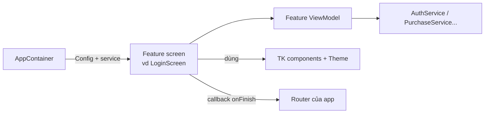

# TitanFeatures

[← Về tổng quan](../README.md)

## 1. Một câu tóm tắt

TitanFeatures là bộ màn hình dựng sẵn (Splash, Onboarding, Login, Paywall, Settings...) mà app chỉ cần cấu hình bằng một struct `Config` và vài callback, giao diện tự theo theme của app.

## 2. Trách nhiệm

- Cung cấp các màn hình chung mà app nào cũng cần, đã xử lý loading, lỗi, mất mạng.
- Mỗi màn hình nhận `Config` (nội dung, tùy chọn) và callback (việc xảy ra khi người dùng làm gì).
- Chỉ dùng component `TK*` và token của [DesignSystem.md](DesignSystem.md), nên đổi theme là đổi giao diện.
- Gọi dịch vụ qua protocol (`AuthService`, `PurchaseService`...), không biết Firebase.
- Không tự điều hướng: báo kết quả qua callback để app hoặc Router quyết định đi đâu.

## 3. Sơ đồ



## 4. API chính

Mọi màn hình theo cùng một dạng:

```swift
public struct LoginConfig: Sendable {
    public var methods: [LoginMethod] = [.apple, .google, .email]
    public var logo: ImageResource?
    public var termsURL: URL
    public var privacyURL: URL
    public var allowsGuest: Bool = false
}

public struct LoginScreen: View {
    public init(
        config: LoginConfig,
        auth: any AuthService,
        onSuccess: @escaping (User) -> Void,
        onSkip: (() -> Void)? = nil
    )
}
```

Danh sách màn hình:

| Màn hình | Config chính | Callback chính | Dịch vụ dùng |
| --- | --- | --- | --- |
| `SplashScreen` | logo, thời gian tối thiểu | `onResult(LaunchStatus)` | RemoteConfig |
| `OnboardingScreen` | danh sách trang (ảnh, tiêu đề, mô tả) | `onFinish` | — |
| `LoginScreen` | phương thức đăng nhập, link điều khoản | `onSuccess(User)`, `onSkip` | Auth |
| `PaywallScreen` | product ID, lợi ích, kiểu bố cục | `onPurchased`, `onClose` | Purchase |
| `SettingsScreen` | danh sách mục, link hỗ trợ | `onLogout`, `onSelect(item)` | Auth, Localization |
| `ProfileScreen` | trường cho phép sửa | `onSaved` | Auth |
| `DeleteAccountScreen` | lý do, cảnh báo | `onDeleted` | Auth |
| `RateAppPrompt` | số lần mở app / sự kiện trước khi hỏi | — | Storage |
| `WebPageScreen` | URL, tiêu đề (Terms, Privacy) | `onClose` | — |
| `MaintenanceScreen` | thông điệp | `onRetry` | RemoteConfig |
| `ForceUpdateScreen` | link App Store | — | — |
| `StateView` | `.offline`, `.error(Error)`, `.empty(EmptyConfig)` | `onRetry` | — |

`StateView` dùng được trong màn hình riêng của app:

```swift
TKAsyncContent(state: viewModel.state) { items in
    ItemList(items: items)
} empty: {
    StateView(.empty(EmptyConfig(title: "list.empty.title", icon: .tray)))
}
```

## 5. Design pattern áp dụng và lý do

| Pattern | Dùng ở đâu | Lý do |
| --- | --- | --- |
| MVVM | Mỗi màn hình có ViewModel riêng | Test logic không cần giao diện |
| Strategy (Config) | `LoginConfig`, `PaywallConfig`... | Đổi hành vi bằng dữ liệu, không sửa code |
| Callback / Delegate | `onSuccess`, `onFinish` | Màn hình không biết luồng của app |
| Template Method (slot) | `header`, `footer` ViewBuilder tùy chọn | Thay một phần màn hình mà không viết lại |
| Dependency Injection | Service truyền qua `init` | Dùng Mock trong preview và test |

## 6. Cấu trúc thư mục

```
Packages/TitanKit/Sources/TitanFeatures/
├── Splash/{SplashScreen, SplashViewModel, SplashConfig}.swift
├── Onboarding/
├── Login/
├── Paywall/
├── Settings/
├── Profile/
├── DeleteAccount/
├── RateApp/
├── WebPage/
├── Maintenance/
├── ForceUpdate/
└── States/{StateView, EmptyConfig}.swift
```

Mỗi thư mục có `Screen`, `ViewModel`, `Config` và có thể có view con. Chuỗi hiển thị nằm trong `TitanKit.xcstrings` (xem [Localization.md](Localization.md)).

## 7. App sử dụng thế nào

Có 3 mức tùy biến, đi từ dễ đến khó:

1. **Cấu hình**: chỉ truyền `Config` khác. Đủ cho phần lớn trường hợp.

```swift
case .login:
    LoginScreen(
        config: .init(methods: [.apple, .email], termsURL: AppConfig.termsURL, privacyURL: AppConfig.privacyURL),
        auth: container.auth,
        onSuccess: { _ in router.replaceRoot(.home) }
    )
```

2. **Theme và slot**: giao diện tự đổi theo theme của app. Muốn thêm ảnh minh họa hay khối riêng thì dùng slot `header` / `footer`.
3. **Thay thế**: viết màn hình riêng trong `Apps/App1/Sources/Features/Login/` và gắn vào cùng `Route`. Vẫn dùng lại `AuthService`, nên logic đăng nhập không phải viết lại. Chỉ chọn cách này khi design khác hẳn bố cục của kit.

Quy tắc: nếu cần sửa màn hình kit cho một app, hãy thêm tùy chọn vào `Config` thay vì rẽ nhánh theo tên app.

## 8. Test

- Unit test ViewModel của mỗi màn hình với service Mock: thành công, lỗi, hủy, mất mạng.
- Snapshot test mỗi màn hình với base theme, theme tối và một brand theme mẫu, ở `vi` và `en`.
- Mỗi màn hình có trang trong Catalog để xem nhanh các trạng thái.
- Test riêng `RateAppPrompt`: chỉ hỏi khi đủ điều kiện và không hỏi lại quá giới hạn.

## 9. Checklist cho App 1

- [ ] Chọn màn hình App 1 dùng: Splash, Onboarding, Login, Paywall, Settings, Profile, Delete account...
- [ ] Viết `Config` cho từng màn hình trong `Apps/App1/Sources/Config/`.
- [ ] Nối callback vào Router của App 1 (xem [Navigation.md](Navigation.md)).
- [ ] Gắn link Terms và Privacy thật.
- [ ] So từng màn hình với Figma của App 1, quyết định cấu hình, dùng slot hay thay thế.
- [ ] Kiểm tra Maintenance, Force update, Offline hiển thị đúng.
- [ ] Bật `RateAppPrompt` sau một hành động tích cực của người dùng, không phải lúc mở app.
