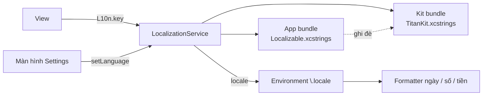

# TitanLocalization

[← Về tổng quan](../README.md)

## 1. Một câu tóm tắt

TitanLocalization quản lý chuỗi đa ngôn ngữ bằng String Catalog (`.xcstrings`), cho đổi ngôn ngữ ngay trong app và định dạng ngày, số, tiền tệ theo ngôn ngữ đang chọn.

## 2. Trách nhiệm

- Chứa chuỗi của kit (nút, lỗi, màn hình dựng sẵn) trong String Catalog riêng của kit.
- Cho app có String Catalog riêng và ghi đè chuỗi của kit khi cần.
- Đổi ngôn ngữ trong app mà không cần khởi động lại.
- Định dạng ngày, giờ, số, phần trăm, tiền tệ theo `Locale` hiện tại.
- Hỗ trợ ngôn ngữ viết từ phải sang trái (RTL) qua `layoutDirection`.

Không làm: dịch tự động, tải bản dịch từ server.

## 3. Sơ đồ



## 4. API chính

Service:

```swift
@MainActor
public protocol LocalizationService: AnyObject, ObservableObject {
    var currentLanguage: Language { get }
    var supportedLanguages: [Language] { get }
    var locale: Locale { get }
    func setLanguage(_ language: Language)
    func string(_ key: String, table: StringTable) -> String
}

public struct Language: Hashable, Sendable, Identifiable {
    public let code: String          // "vi", "en"
    public var id: String { code }
    public var displayName: String   // tên bằng chính ngôn ngữ đó
}

public enum StringTable: Sendable { case app, kit }
```

Thứ tự tra chuỗi: bảng của app trước, không có thì dùng bảng của kit, không có nữa thì trả về chính key. Nhờ vậy app ghi đè được chuỗi của kit chỉ bằng cách thêm cùng key vào catalog của mình.

Chuỗi trong kit dùng hằng có kiểu để tránh gõ sai:

```swift
public enum KitStrings {
    public static let retry = "kit.common.retry"
    public static let offlineTitle = "kit.error.offline.title"
}
```

Định dạng:

```swift
public struct TKFormatter {
    public init(locale: Locale)
    public func date(_ date: Date, style: Date.FormatStyle.DateStyle = .abbreviated) -> String
    public func number(_ value: Double, fractionDigits: Int = 0) -> String
    public func percent(_ value: Double) -> String
    public func currency(_ value: Decimal, code: String) -> String
}
```

Giá sản phẩm in-app purchase không định dạng tay: dùng `displayPrice` từ StoreKit (xem [Purchase.md](Purchase.md)).

## 5. Design pattern áp dụng và lý do

| Pattern | Dùng ở đâu | Lý do |
| --- | --- | --- |
| Chain of Responsibility (tra theo thứ tự) | App bundle → kit bundle → key | App ghi đè chuỗi kit mà không sửa kit |
| Observer | `ObservableObject` + `@Published currentLanguage` | Đổi ngôn ngữ thì giao diện vẽ lại ngay |
| Environment injection | `.environment(\.locale, ...)` | Formatter và `Text` của SwiftUI tự theo ngôn ngữ |
| Facade | `LocalizationService` | Che đi chuyện bundle, `.lproj`, UserDefaults |

## 6. Cấu trúc thư mục

```
Packages/TitanKit/Sources/TitanLocalization/
├── LocalizationService.swift
├── DefaultLocalizationService.swift
├── Language.swift
├── KitStrings.swift
├── TKFormatter.swift
├── View+Localization.swift
└── Resources/TitanKit.xcstrings
Apps/App1/Resources/
├── Localizable.xcstrings      # chuỗi của app và chuỗi ghi đè kit
└── InfoPlist.xcstrings        # tên app, câu xin quyền
```

## 7. App sử dụng thế nào

1. Khai báo ngôn ngữ hỗ trợ trong `AppConfig.swift`:

```swift
static let languages: [String] = ["vi", "en"]
static let defaultLanguage = "vi"
```

2. Tạo service trong `AppContainer` và gắn vào gốc giao diện:

```swift
RootView()
    .environmentObject(container.localization)
    .environment(\.locale, container.localization.locale)
    .id(container.localization.currentLanguage) // vẽ lại toàn bộ khi đổi ngôn ngữ
```

3. Viết chuỗi trong View bằng key: `Text("home.title")`. Xcode tự thêm key vào `Localizable.xcstrings` khi build.
4. Muốn đổi chữ của màn hình dựng sẵn, thêm key của kit (ví dụ `kit.common.retry`) vào catalog của app với nội dung mới.
5. Màn hình Settings dựng sẵn đã có mục chọn ngôn ngữ, gọi `setLanguage`. Lựa chọn được lưu qua TitanStorage.
6. Câu xin quyền (camera, ATT, thông báo) đặt trong `InfoPlist.xcstrings`. Phần này theo ngôn ngữ hệ thống, không đổi theo ngôn ngữ trong app.

Quy ước key: `<màn hình>.<thành phần>.<vai trò>`, ví dụ `login.button.submit`. Chuỗi của kit luôn bắt đầu bằng `kit.`.

## 8. Test

- `LocalizationServiceTests`: app ghi đè được key của kit; thiếu key thì trả về key; `setLanguage` đổi `locale` và được lưu lại.
- `TKFormatterTests`: cùng một số tiền ra `1.000 ₫` với `vi` và `₫1,000` với `en`; ngày theo đúng thứ tự từng ngôn ngữ.
- Snapshot test màn hình dựng sẵn ở cả `vi` và `en`, thêm một bản với chuỗi dài (pseudo-language) để bắt lỗi tràn chữ.
- CI chạy script báo lỗi nếu catalog còn chuỗi trạng thái `new` hoặc `needs review` trước khi phát hành.

## 9. Checklist cho App 1

- [ ] Chốt danh sách ngôn ngữ của App 1 (đề xuất: `vi`, `en`).
- [ ] Tạo `Localizable.xcstrings` và `InfoPlist.xcstrings` trong `Apps/App1/Resources/`.
- [ ] Dịch tên app và mọi câu xin quyền.
- [ ] Gắn `LocalizationService` và `\.locale` ở gốc giao diện.
- [ ] Kiểm tra đổi ngôn ngữ trong Settings cập nhật toàn bộ màn hình.
- [ ] Kiểm tra định dạng ngày và tiền ở cả hai ngôn ngữ.
- [ ] Không còn chuỗi cứng tiếng Việt hay tiếng Anh trong code.
