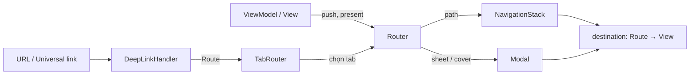

# TitanNavigation

[← Về tổng quan](../README.md)

## 1. Tóm tắt

TitanNavigation điều hướng bằng enum `Route` của từng app: đẩy màn hình qua `NavigationStack`, mở sheet/fullScreenCover, chuyển tab, và biến URL deep link hoặc universal link thành `Route`.

## 2. Trách nhiệm

**Làm:**
- `Router<Route>` giữ `path`, sheet và fullScreenCover hiện tại.
- `TabRouter<Tab>` giữ tab đang chọn, mỗi tab có `Router` riêng.
- `RouterView` nối `Router` với `NavigationStack` và các modifier trình bày.
- `DeepLinkHandler` parse URL (custom scheme và universal link) thành `Route`.

**Không làm:**
- Không định nghĩa route cụ thể (mỗi app tự khai báo enum `Route`).
- Không tạo ViewModel hay service (app làm qua `AppContainer`).
- Không kiểm tra đăng nhập; app quyết định có cho đi tiếp hay không.

## 3. Sơ đồ



## 4. API chính

```swift
public protocol Routable: Hashable, Identifiable, Sendable { }
public extension Routable { var id: Self { self } }

@MainActor
public final class Router<Route: Routable>: ObservableObject {
    @Published public var path: [Route] = []
    @Published public var sheet: Route?
    @Published public var fullScreenCover: Route?

    public init() { }
    public func push(_ route: Route) { path.append(route) }
    public func pop() { _ = path.popLast() }
    public func popToRoot() { path.removeAll() }
    public func present(_ route: Route, fullScreen: Bool = false) {
        if fullScreen { fullScreenCover = route } else { sheet = route }
    }
    public func dismiss() { sheet = nil; fullScreenCover = nil }
}

public struct RouterView<Route: Routable, Root: View, Destination: View>: View {
    public init(router: Router<Route>,
                @ViewBuilder root: () -> Root,
                @ViewBuilder destination: @escaping (Route) -> Destination) { }
    // body: NavigationStack(path:) + .navigationDestination + .sheet + .fullScreenCover
}

@MainActor
public final class TabRouter<Tab: Hashable & CaseIterable & Sendable, Route: Routable>: ObservableObject {
    @Published public var selected: Tab
    public private(set) var routers: [Tab: Router<Route>]
    public init(initial: Tab) { }
    public func router(for tab: Tab) -> Router<Route> { routers[tab]! }
    public func open(_ route: Route, in tab: Tab) { selected = tab; router(for: tab).push(route) }
}

public protocol DeepLinkParser: Sendable {
    associatedtype Route: Routable
    func route(from url: URL) -> DeepLink<Route>?
}
public struct DeepLink<Route: Routable>: Sendable {
    public let route: Route
    public let presentation: Presentation   // .push, .sheet, .fullScreen
}

@MainActor
public final class DeepLinkHandler<Parser: DeepLinkParser> {
    public init(parser: Parser, onRoute: @escaping (DeepLink<Parser.Route>) -> Void) { }
    public func handle(_ url: URL) -> Bool   // false nếu URL không hợp lệ
}
```

## 5. Design pattern áp dụng và lý do

| Pattern | Ở đâu | Lý do |
| --- | --- | --- |
| Router / Coordinator | `Router`, `TabRouter` | View không tự tạo màn hình đích, điều hướng tập trung một chỗ |
| Enum route | `Route` của app | Trình biên dịch kiểm tra đủ case, deep link và push dùng chung một kiểu |
| Strategy | `DeepLinkParser` | Mỗi app tự định nghĩa cách đọc URL, handler dùng chung |
| Observer | `@Published path` | `NavigationStack` tự cập nhật khi path đổi |

## 6. Cấu trúc thư mục

```
Sources/TitanNavigation/
├── Router/          # Routable.swift, Router.swift, RouterView.swift
├── Tabs/            # TabRouter.swift, TabRouterView.swift
├── DeepLink/        # DeepLinkParser.swift, DeepLink.swift, DeepLinkHandler.swift
└── Helpers/         # URL+QueryItems.swift
Tests/TitanNavigationTests/
```

## 7. App sử dụng thế nào

```swift
// Apps/App1/Sources/Navigation/AppRoute.swift
enum AppRoute: Routable {
    case workoutDetail(id: String)
    case settings
    case paywall
}
enum AppTab: CaseIterable { case home, history, profile }

struct App1DeepLinkParser: DeepLinkParser {
    // app1://workout/123  hoặc  https://app1.example.com/workout/123
    func route(from url: URL) -> DeepLink<AppRoute>? {
        let parts = url.pathComponents.filter { $0 != "/" }
        let segments = url.scheme == "app1" ? [url.host ?? ""] + parts : parts
        switch segments.first {
        case "workout" where segments.count > 1:
            return DeepLink(route: .workoutDetail(id: segments[1]), presentation: .push)
        case "premium": return DeepLink(route: .paywall, presentation: .sheet)
        default: return nil
        }
    }
}

// AppContainer.swift
let tabs = TabRouter<AppTab, AppRoute>(initial: .home)
lazy var deepLinks = DeepLinkHandler(parser: App1DeepLinkParser()) { [tabs] link in
    tabs.open(link.route, in: .home)
}

// Root view
TabView(selection: $tabs.selected) {
    RouterView(router: tabs.router(for: .home)) { HomeView() }
        destination: { route in container.makeView(for: route) }
        .tag(AppTab.home)
}
.onOpenURL { _ = container.deepLinks.handle($0) }
```

Universal link: thêm Associated Domains `applinks:app1.example.com` trong entitlements và đặt file `apple-app-site-association` trên server. Cả hai loại link đi chung qua `onOpenURL`.

## 8. Test

- Test `Router`: `push`, `pop`, `present`, `dismiss` thay đổi đúng state.
- Test `DeepLinkParser` bằng bảng URL → Route, gồm cả URL sai trả `nil`.
- Test `TabRouter.open` đổi tab và push đúng router.
- Không cần mock riêng: `Router` là class thuần, tạo trực tiếp trong test. ViewModel nhận `Router` qua init nên kiểm tra được `router.path` sau khi gọi action.

```swift
@MainActor func testWorkoutLink() {
    let link = App1DeepLinkParser().route(from: URL(string: "app1://workout/42")!)
    XCTAssertEqual(link?.route, .workoutDetail(id: "42"))
}
```

## 9. Checklist cho App 1

- [ ] Khai báo `AppRoute` và `AppTab`
- [ ] Viết `container.makeView(for:)` ánh xạ Route → View
- [ ] Tạo `TabRouter` trong `AppContainer` và gắn vào root
- [ ] Đăng ký URL scheme `app1` trong Info.plist
- [ ] Cấu hình Associated Domains và file `apple-app-site-association`
- [ ] Viết `App1DeepLinkParser` và test cho từng URL
- [ ] Deep link tới màn cần đăng nhập: lưu lại, mở sau khi đăng nhập xong
