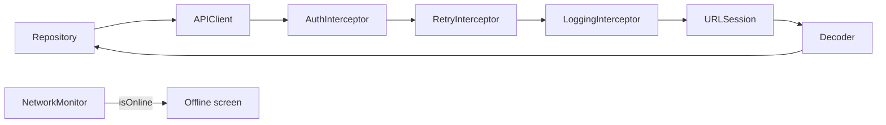

# TitanNetworking

[← Về tổng quan](../README.md)

## 1. Tóm tắt

TitanNetworking gửi request HTTP bằng async/await, mô tả request bằng `Endpoint`, xử lý token, retry và log qua chuỗi interceptor, và theo dõi trạng thái mạng cho màn hình offline.

## 2. Trách nhiệm

**Làm:**
- Định nghĩa `Endpoint` để mô tả một request (path, method, query, body).
- `APIClient` gửi request, kiểm tra status code, decode JSON thành model.
- Chuỗi interceptor: gắn token, retry có backoff, log request/response.
- Chuyển mọi lỗi về `TitanError` (từ TitanCore).
- `NetworkMonitor` báo online/offline để app hiện màn hình mất mạng.
- `MockAPIClient` cho test và preview.

**Không làm:**
- Không biết endpoint cụ thể của app (app tự khai báo).
- Không lưu token (đọc từ `TokenProvider`, thường do TitanAuth cung cấp).
- Không cache dữ liệu lâu dài (việc của TitanStorage).

## 3. Sơ đồ



## 4. API chính

```swift
public enum HTTPMethod: String, Sendable { case get = "GET", post = "POST", put = "PUT", patch = "PATCH", delete = "DELETE" }

public protocol Endpoint: Sendable {
    associatedtype Response: Decodable & Sendable
    var path: String { get }
    var method: HTTPMethod { get }
    var query: [String: String] { get }
    var body: (any Encodable & Sendable)? { get }
    var requiresAuth: Bool { get }
}
public extension Endpoint {
    var method: HTTPMethod { .get }
    var query: [String: String] { [:] }
    var body: (any Encodable & Sendable)? { nil }
    var requiresAuth: Bool { true }
}

public protocol APIClient: Sendable {
    func send<E: Endpoint>(_ endpoint: E) async throws(TitanError) -> E.Response
}

public protocol Interceptor: Sendable {
    func intercept(_ request: URLRequest,
                   next: @Sendable (URLRequest) async throws -> (Data, HTTPURLResponse)
    ) async throws -> (Data, HTTPURLResponse)
}

public protocol TokenProvider: Sendable {
    func accessToken() async -> String?
    func refreshToken() async throws -> String
}

public final class DefaultAPIClient: APIClient {
    public init(baseURL: URL,
                session: URLSession = .shared,
                interceptors: [any Interceptor],
                decoder: JSONDecoder = .titan) { }
}

// Interceptor có sẵn
public struct AuthInterceptor: Interceptor { public init(tokens: any TokenProvider) { } }
public struct RetryInterceptor: Interceptor {
    public init(maxAttempts: Int = 3, baseDelay: Duration = .milliseconds(500)) { }
}
public struct LoggingInterceptor: Interceptor { public init(logger: any Logging) { } }

// Theo dõi mạng
@MainActor
public final class NetworkMonitor: ObservableObject {
    @Published public private(set) var isOnline = true
    public init() { }   // dùng NWPathMonitor bên trong
}
```

Ghi chú:
- Endpoint không có body trả về thì dùng `typealias Response = EmptyResponse`.
- Interceptor nào chỉ dành cho request cần đăng nhập thì trả `appliesOnlyToAuthenticatedRequests = true` (như `AuthInterceptor`); client tự bỏ qua nó khi `requiresAuth = false`.
- `JSONDecoder.titan` dùng `convertFromSnakeCase` và ngày ISO8601.
- `AuthInterceptor` gặp 401 thì gọi `refreshToken()` một lần rồi gửi lại; vẫn 401 thì ném `.unauthorized`.
- `RetryInterceptor` chỉ retry lỗi mạng, timeout và 5xx; chờ `baseDelay * 2^n` (exponential backoff).

## 5. Design pattern áp dụng và lý do

| Pattern | Ở đâu | Lý do |
| --- | --- | --- |
| Builder / Endpoint | `Endpoint` | Mỗi request là một struct nhỏ, dễ đọc, dễ test |
| Chain of Responsibility | `Interceptor` | Thêm, bỏ, đổi thứ tự token/retry/log mà không sửa `APIClient` |
| Adapter | `TokenProvider` | Networking không phụ thuộc TitanAuth hay Firebase |
| Observer | `NetworkMonitor` (`@Published`) | View tự cập nhật khi mất hoặc có mạng |

## 6. Cấu trúc thư mục

```
Sources/TitanNetworking/
├── Endpoint/        # Endpoint.swift, HTTPMethod.swift
├── Client/          # APIClient.swift, DefaultAPIClient.swift
├── Interceptors/    # Interceptor.swift, Auth/Retry/LoggingInterceptor.swift
├── Decoding/        # JSONDecoder+Titan.swift
├── Reachability/    # NetworkMonitor.swift
└── Mock/            # MockAPIClient.swift
Tests/TitanNetworkingTests/
```

## 7. App sử dụng thế nào

```swift
// Khai báo endpoint trong app
struct GetProfile: Endpoint {
    typealias Response = UserDTO
    var path: String { "/v1/me" }
}

// AppContainer.swift
let api: any APIClient = DefaultAPIClient(
    baseURL: config.apiBaseURL,            // khác nhau theo dev/staging/prod
    interceptors: [
        AuthInterceptor(tokens: authService),
        RetryInterceptor(),
        LoggingInterceptor(logger: logger)
    ]
)
let networkMonitor = NetworkMonitor()

// Repository
func profile() async throws(TitanError) -> User {
    try await api.send(GetProfile()).toDomain()
}

// Root view: hiện màn hình offline
if !networkMonitor.isOnline { TKErrorView(error: .network(.offline), retry: reload) }
```

## 8. Test

- `MockAPIClient`: đăng ký kết quả theo kiểu endpoint, ghi lại các request đã gửi.
- Test interceptor bằng `next` giả: ví dụ trả 401 rồi 200 để kiểm tra refresh token.
- Test `RetryInterceptor` với `maxAttempts` và `baseDelay = .zero` để chạy nhanh.
- Test decode bằng file JSON mẫu trong `Tests/Fixtures`.

```swift
let api = MockAPIClient()
api.stub(GetProfile.self, with: .success(UserDTO.sample))
let repo = UserRepositoryImpl(api: api)
let user = try await repo.profile()
XCTAssertEqual(api.sentPaths, ["/v1/me"])
```

## 9. Checklist cho App 1

- [ ] Đặt `API_BASE_URL` cho dev/staging/prod trong xcconfig
- [ ] Khai báo các `Endpoint` của App 1 trong `Sources/Data/Endpoints/`
- [ ] Tạo `DefaultAPIClient` với đủ 3 interceptor trong `AppContainer`
- [ ] Nối `TokenProvider` với service đăng nhập
- [ ] Gắn `NetworkMonitor` vào root view và hiện màn hình offline
- [ ] Tắt log body ở prod
- [ ] Viết test Repository với `MockAPIClient`
