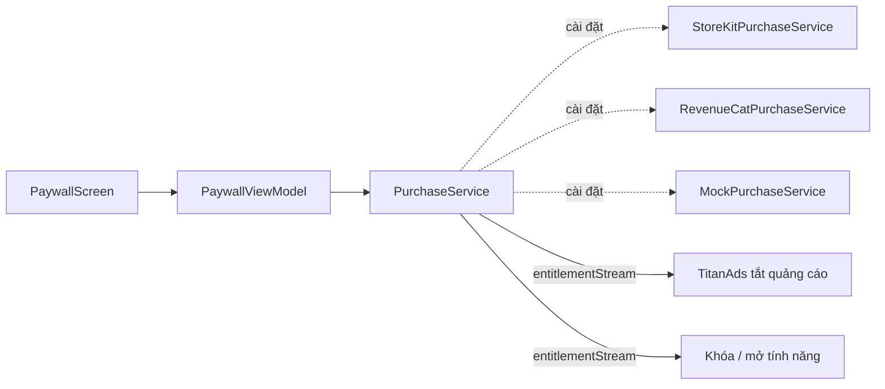

# TitanPurchase

[← Về tổng quan](../README.md) · [Backend & adapter](Backend.md)

TitanPurchase bán gói mua trong app và gói thuê bao bằng StoreKit 2, rồi cho app biết người dùng có quyền premium hay không.

## 1. Trách nhiệm

**Làm:**
- Tải danh sách sản phẩm (`Product`) theo ID trong `AppConfig`.
- Mua, khôi phục (restore), lắng nghe giao dịch mới và giao dịch được gia hạn.
- Tính quyền (`Entitlement`) và phát trạng thái premium cho toàn app.
- Cho phép thay StoreKit 2 bằng RevenueCat qua adapter.

**Không làm:**
- Không vẽ màn hình bán hàng (đó là `PaywallScreen` trong TitanFeatures).
- Không tự tắt quảng cáo. TitanAds đọc trạng thái premium từ đây.
- Không lưu quyền premium trên server riêng ở giai đoạn này. StoreKit là nguồn sự thật.

## 2. Sơ đồ



## 3. API chính

```swift
public struct StoreProduct: Sendable, Identifiable, Equatable {
    public let id: String
    public let displayName: String
    public let displayPrice: String          // đã định dạng theo vùng
    public let kind: Kind
    public let subscriptionPeriod: Period?   // nil nếu không phải thuê bao
    public let introOffer: String?           // ví dụ "Dùng thử 7 ngày"
    public enum Kind: Sendable { case consumable, nonConsumable, autoRenewable }
    public enum Period: Sendable { case week, month, year }
}

public struct Entitlements: Sendable, Equatable {
    public var isPremium: Bool
    public var activeProductIds: Set<String>
    public var expiresAt: Date?
    public static let none = Entitlements(isPremium: false, activeProductIds: [], expiresAt: nil)
}

public enum PurchaseResult: Sendable { case success, pending, cancelled }

/// Mọi hàm chỉ ném `TitanError` (ví dụ `.network(.offline)`, `.unknown`).
public protocol PurchaseService: Sendable {
    var entitlements: Entitlements { get }
    var entitlementStream: AsyncStream<Entitlements> { get }

    func products(ids: [String]) async throws -> [StoreProduct]
    func purchase(_ productId: String) async throws -> PurchaseResult
    func restore() async throws -> Entitlements
    func start()   // gọi một lần lúc mở app: lắng nghe Transaction.updates
}
```

Cấu hình sản phẩm nằm ở app, không viết cứng trong kit:

```swift
public struct PurchaseConfig: Sendable {
    public let productIds: [String]
    public let premiumProductIds: Set<String>   // gói nào mở premium
}
```

### Cách StoreKit adapter tính premium

1. `start()` duyệt `Transaction.currentEntitlements` và lắng nghe `Transaction.updates`.
2. Chỉ tin giao dịch `.verified`. Giao dịch `.unverified` bị bỏ qua và ghi log.
3. Gọi `transaction.finish()` sau khi đã cập nhật quyền.
4. Có ít nhất một sản phẩm trong `premiumProductIds` còn hạn → `isPremium = true`.
5. Lưu bản sao `Entitlements` vào TitanStorage để lần mở app sau hiện đúng ngay, trước khi StoreKit trả lời.

## 4. Design pattern áp dụng và lý do

| Pattern | Lý do |
| --- | --- |
| Adapter | StoreKit 2 mặc định, RevenueCat khi cần phân tích doanh thu hoặc A/B test paywall |
| Observer (`AsyncStream`) | Ads, Paywall và tính năng khóa cùng nghe một nguồn trạng thái premium |
| Strategy | `PurchaseConfig` quyết định gói nào là premium, mỗi app khác nhau |
| Facade | Che phần xác minh giao dịch, `finish()`, gia hạn của StoreKit |

## 5. Cấu trúc thư mục

```
Packages/TitanKit/Sources/TitanPurchase/
├── PurchaseService.swift
├── Models/{StoreProduct, Entitlements, PurchaseConfig}.swift
├── StoreKit/StoreKitPurchaseService.swift
├── EntitlementCache.swift
└── Mock/MockPurchaseService.swift
Adapters/TitanRevenueCat/                    # tùy chọn, package riêng
└── Sources/TitanRevenueCat/RevenueCatPurchaseService.swift
```

StoreKit adapter nằm ngay trong kit vì StoreKit là framework hệ thống, không thêm SDK ngoài.

## 6. App sử dụng thế nào

```swift
// AppContainer.swift
let purchase: PurchaseService = StoreKitPurchaseService(config: .init(
    productIds: ["app1.premium.monthly", "app1.premium.yearly"],
    premiumProductIds: ["app1.premium.monthly", "app1.premium.yearly"]))
purchase.start()
```

```swift
// Màn Paywall dựng sẵn chỉ cần service
PaywallScreen(viewModel: PaywallViewModel(purchase: container.purchase,
                                          analytics: container.analytics))
```

Khóa một tính năng trong màn hình riêng của app:

```swift
@MainActor final class ExportViewModel: ObservableObject {
    @Published var isPremium = false
    func observe(_ purchase: PurchaseService) async {
        for await e in purchase.entitlementStream { isPremium = e.isPremium }
    }
}
// View: nếu !isPremium thì router.present(.paywall)
```

## 7. Test

- `MockPurchaseService`: danh sách sản phẩm cố định, đặt trước kết quả mua (`.success`, `.cancelled`) và phát `Entitlements` bằng tay.
- `Apps/Dolingo/Dolingo.storekit` (StoreKit Configuration) gắn vào scheme `Dolingo-Dev`: chạy từ Xcode là mua thử được trên Simulator và iPhone, không cần App Store Connect. Hai gói giống `AppConfig.purchase`: tháng 99.000 ₫, năm 599.000 ₫ có 7 ngày dùng thử, cửa hàng Việt Nam. Xcode → Debug → StoreKit → Manage Transactions để huỷ, hoàn tiền hay xoá giao dịch; Editor → Subscription Renewal Rate để gia hạn nhanh. Staging và Prod dùng sandbox của App Store.
- Unit test với `StoreKitTest` (`SKTestSession`): mua, hết hạn, gia hạn, hoàn tiền, restore.
- Test `PaywallViewModel`: `.cancelled` không hiện lỗi, `.pending` hiện thông báo chờ phụ huynh duyệt.

## 7b. Đã làm (giai đoạn 4, đợt 1)

- `PurchaseService` dùng typed throws (`throws(TitanError)`): mất mạng là `.network(.offline)`, sản phẩm không có là `.notFound`, người dùng huỷ trong hộp mua của Apple trả về `.cancelled` chứ không ném lỗi.
- `entitlementStream` tạo stream mới mỗi lần đọc, phát ngay giá trị hiện tại rồi mỗi lần đổi. `EntitlementBroadcaster` dùng chung cho StoreKit và Mock.
- `StoreProduct` có `freeTrialDays` thay cho chuỗi `introOffer`, để Paywall tự viết "Dùng thử 7 ngày" theo ngôn ngữ đang chọn. `Period` có thêm `.day`; gói 3 tháng hiện vẫn hiện là `.month`.
- `StoreKitPurchaseService`: chỉ tin giao dịch đã xác minh, bỏ giao dịch đã hoàn tiền, gói trọn đời (không hết hạn) thắng mọi ngày hết hạn. Quyền được lưu bằng `UserDefaultsEntitlementCache` để lần mở sau hiện premium ngay.
- `MockPurchaseService`: có hai gói mẫu (tháng có 7 ngày dùng thử, năm), `nextResult`, `failCalls(with:)`, `setEntitlements`.
- Dolingo: `AppConfig.purchase` có hai ID gói giả `com.titanstudio.dolingo.premium.monthly` và `.yearly`, `AppContainer.purchase` dùng StoreKit, gọi `start()` lúc mở app. Preview và test dùng Mock.
- Chưa làm: RevenueCat. (`Dolingo.storekit` và `PaywallScreen` đã có.)

## 8. Checklist cho App 1

- [ ] Tạo sản phẩm và nhóm thuê bao trên App Store Connect
- [x] Tạo file `Dolingo.storekit` khớp với ID sản phẩm (giá thật đặt trên App Store Connect)
- [ ] Điền `PurchaseConfig` trong `AppConfig`
- [ ] Gọi `purchase.start()` lúc mở app
- [ ] Paywall có nút Restore, link Điều khoản và Chính sách quyền riêng tư
- [ ] Hiển thị đúng giá, kỳ hạn và dùng thử theo yêu cầu của Apple
- [ ] TitanAds nghe `entitlementStream` để tắt quảng cáo
- [ ] Test mua bằng tài khoản Sandbox trên máy thật
