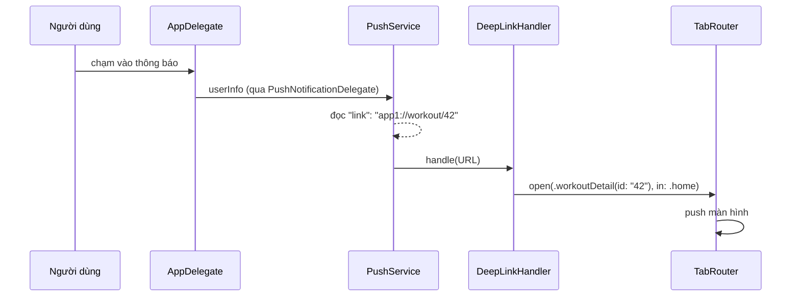

# TitanPush

[← Về tổng quan](../README.md) · [Backend & adapter](Backend.md) · [Navigation](Navigation.md)

TitanPush xin quyền thông báo, đăng ký token thiết bị với server và biến cú chạm vào thông báo thành một `Route` của TitanNavigation.

## 1. Trách nhiệm

**Làm:**
- Xin quyền thông báo vào thời điểm app chọn (không xin ngay khi mở app).
- Lấy APNs device token và token của nhà cung cấp (FCM), gửi cho backend qua callback.
- Nhận thông báo khi app đang mở (foreground) và quyết định có hiện banner không.
- Đọc payload khi người dùng chạm vào thông báo, chuyển thành deep link URL rồi đưa cho Router.

**Không làm:**
- Không gửi thông báo (đó là việc của server hoặc Firebase Console).
- Không tự điều hướng màn hình. Chỉ trả `URL`, TitanNavigation đổi URL thành `Route`.
- Không lưu token vào cơ sở dữ liệu. App lưu qua Repository của nó.

## 2. Sơ đồ



## 3. API chính

```swift
public enum PushAuthorization: Sendable { case notDetermined, denied, authorized, provisional }

public struct PushMessage: Sendable {
    public let title: String?
    public let body: String?
    public let link: URL?                 // lấy từ khóa "link" trong payload
    public let data: [String: String]
}

@MainActor
public protocol PushService: AnyObject {
    var authorization: PushAuthorization { get async }
    var tokenStream: AsyncStream<String> { get }     // token để gửi lên server
    var tapStream: AsyncStream<PushMessage> { get }  // người dùng chạm thông báo

    func requestAuthorization() async -> PushAuthorization
    func register()                                    // gọi registerForRemoteNotifications
    func didRegister(deviceToken: Data)                // từ AppDelegate
    func subscribe(topic: String) async throws
    func unsubscribe(topic: String) async throws
}
```

Payload chuẩn mà mọi app dùng chung:

```json
{
  "aps": { "alert": { "title": "Bài tập mới", "body": "HIIT 15 phút đã sẵn sàng" } },
  "link": "app1://workout/42"
}
```

`PushNotificationDelegate` trong kit cài đặt `UNUserNotificationCenterDelegate`, đọc khóa `link` và phát vào `tapStream`. Nhờ vậy thông báo đi chung đường với deep link và universal link: một `DeepLinkParser`, một `DeepLinkHandler` (xem [Navigation.md](Navigation.md)).

### FCM hay APNs trực tiếp

| | FCM adapter (hiện tại) | APNs adapter (sau này) |
| --- | --- | --- |
| Token gửi server | FCM token | APNs device token dạng hex |
| Gửi theo topic | Có sẵn | Server tự làm |
| Gửi từ Console | Có | Không |
| SDK thêm vào app | FirebaseMessaging | Không |
| Khi nào dùng | Đang dùng Firebase | Khi có server riêng |

Cả hai đều cần file APNs key (.p8) trên Apple Developer. Đổi adapter không đổi `PushService`, chỉ đổi loại token server nhận.

## 4. Design pattern áp dụng và lý do

| Pattern | Lý do |
| --- | --- |
| Adapter | `FCMPushService` hôm nay, `APNsPushService` khi có server riêng |
| Observer (`AsyncStream`) | Token đổi và cú chạm được phát ra, app tự quyết định làm gì |
| Mediator | `DeepLinkHandler` là chỗ duy nhất đổi URL thành màn hình, cho push, deep link và universal link |
| Facade | Che `UNUserNotificationCenter`, `AppDelegate` và SDK Firebase sau một API nhỏ |

## 5. Cấu trúc thư mục

```
Packages/TitanKit/Sources/TitanPush/
├── PushService.swift
├── Models/{PushMessage, PushAuthorization}.swift
├── PushNotificationDelegate.swift   # UNUserNotificationCenterDelegate
├── APNs/APNsPushService.swift
├── UI/PushPrimerView.swift          # màn giải thích trước khi xin quyền
└── Mock/MockPushService.swift
Adapters/TitanFirebase/Sources/TitanFirebasePush/FCMPushService.swift
```

## 6. App sử dụng thế nào

```swift
// AppContainer.swift
let push: PushService = FCMPushService()

// App1App.swift
@UIApplicationDelegateAdaptor(AppDelegate.self) var appDelegate
// AppDelegate chuyển deviceToken vào container.push.didRegister(deviceToken:)
```

```swift
// RootView: nối push với Router và lưu token
.task {
    for await message in container.push.tapStream {
        if let url = message.link { _ = container.deepLinks.handle(url) }   // URL → Route
    }
}
.task {
    for await token in container.push.tokenStream {
        try? await container.userRepository.saveDeviceToken(token)
    }
}
```

Xin quyền sau một hành động có ý nghĩa, ví dụ khi người dùng bật nhắc lịch tập:

```swift
if await push.authorization == .notDetermined {
    router.present(.pushPrimer)   // PushPrimerView → requestAuthorization() → register()
}
```

Nếu app đang đóng, cú chạm đến trước khi root view sẵn sàng. `PushNotificationDelegate` giữ thông báo đó lại và phát ra khi `tapStream` có người nghe đầu tiên.

## 7. Test

- `MockPushService`: phát token và cú chạm giả (`mock.simulateTap(link:)`), đặt trước kết quả xin quyền.
- Test nối push với điều hướng: chạm với `app1://workout/42` thì `tabs.router(for: .home).path` có `.workoutDetail(id: "42")`; link sai thì `handle` trả `false` và không đổi gì.
- Test parser payload: thiếu `link`, `link` không hợp lệ, dữ liệu thêm.
- Thử trên Simulator bằng file `.apns` kéo thả hoặc `xcrun simctl push`.

## 8. Checklist cho App 1

- [ ] Bật capability Push Notifications và Background Modes (remote notifications)
- [ ] Tạo APNs key (.p8), tải lên cả 3 Firebase project
- [ ] Nối `AppDelegate` để chuyển device token vào `PushService`
- [ ] Lưu token qua `UserRepository`, xóa khi đăng xuất
- [ ] Thêm `PushPrimerView` và xin quyền ở thời điểm hợp lý
- [ ] Mọi `link` trong payload đều có trong `App1DeepLinkParser`
- [ ] Test chạm thông báo khi app đang mở, chạy nền và đã đóng
- [ ] Gửi thử từ Firebase Console tới bản Dev
