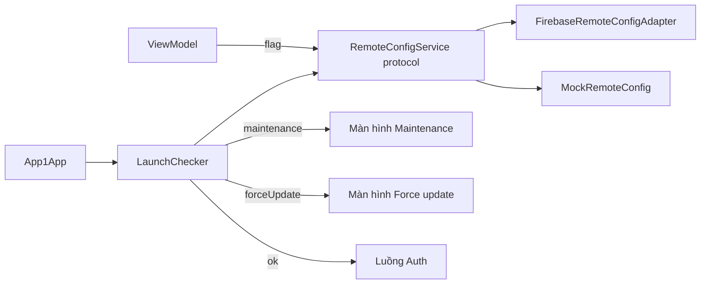

# TitanRemoteConfig

[← Về tổng quan](../README.md)

## 1. Một câu tóm tắt

TitanRemoteConfig cho app đọc cấu hình từ xa (feature flag, chế độ bảo trì, bắt buộc cập nhật) qua một protocol chung, với key có kiểu và giá trị mặc định an toàn.

## 2. Trách nhiệm

- Định nghĩa protocol `RemoteConfigService`, không phụ thuộc Firebase.
- Cung cấp key có kiểu (`RemoteConfigKey<Value>`) kèm giá trị mặc định, để app không bao giờ crash khi thiếu config.
- Quản lý feature flag: bật/tắt tính năng mà không cần phát hành bản mới.
- Kiểm tra lúc khởi động: app có đang bảo trì không, phiên bản hiện tại có bị bắt buộc cập nhật không.
- Cung cấp adapter Firebase Remote Config (nằm trong `TitanFirebase`) và bản Mock để test.

Không làm: A/B test paywall (để sau, xem [README mục 10](../README.md#10-phạm-vi)), lưu cấu hình người dùng (thuộc TitanStorage).

## 3. Sơ đồ



## 4. API chính

Protocol dịch vụ:

```swift
public protocol RemoteConfigService: Sendable {
    func fetchAndActivate() async throws
    func value<V: RemoteConfigValue>(for key: RemoteConfigKey<V>) -> V
}
```

Key có kiểu, luôn có giá trị mặc định:

```swift
public struct RemoteConfigKey<Value: RemoteConfigValue>: Sendable {
    public let name: String
    public let defaultValue: Value
}

// Key dùng chung của kit
public extension RemoteConfigKey where Value == Bool {
    static let maintenanceEnabled = RemoteConfigKey(name: "maintenance_enabled", defaultValue: false)
}
public extension RemoteConfigKey where Value == String {
    static let minimumVersion = RemoteConfigKey(name: "minimum_version", defaultValue: "0.0.0")
    static let maintenanceMessage = RemoteConfigKey(name: "maintenance_message", defaultValue: "")
}
```

`RemoteConfigValue` được cài sẵn cho `Bool`, `Int`, `Double`, `String` và kiểu `Decodable` (đọc từ JSON).

Feature flag của app:

```swift
extension RemoteConfigKey where Value == Bool {
    static let showNewHome = RemoteConfigKey(name: "app1_show_new_home", defaultValue: false)
}

if remoteConfig.value(for: .showNewHome) { ... }
```

Kiểm tra lúc khởi động:

```swift
public enum LaunchStatus: Equatable, Sendable {
    case ok
    case maintenance(message: String)
    case forceUpdate(storeURL: URL)
}

public struct LaunchChecker: Sendable {
    public init(config: RemoteConfigService, appVersion: String, storeURL: URL, timeout: Duration = .seconds(3))
    public func check() async -> LaunchStatus
}
```

`check()` gọi `fetchAndActivate()` với timeout. Nếu lỗi mạng hoặc hết giờ thì dùng giá trị đã cache hoặc mặc định và trả về `.ok`, để app không bị kẹt ở Splash.

## 5. Design pattern áp dụng và lý do

| Pattern | Dùng ở đâu | Lý do |
| --- | --- | --- |
| Adapter | `FirebaseRemoteConfigAdapter` | Đổi nhà cung cấp mà không sửa app |
| Generic typed key | `RemoteConfigKey<Value>` | Sai kiểu bị bắt lúc biên dịch, không dùng chuỗi rời rạc |
| Null Object (giá trị mặc định) | `defaultValue` | Thiếu config vẫn chạy đúng |
| Strategy | `LaunchChecker` trả `LaunchStatus` | App quyết định hiển thị màn hình nào theo kết quả |
| Facade | `RemoteConfigService` | App gọi API gọn, không thấy SDK |

## 6. Cấu trúc thư mục

```
Packages/TitanKit/Sources/TitanRemoteConfig/
├── RemoteConfigService.swift
├── RemoteConfigKey.swift
├── RemoteConfigValue.swift
├── KitKeys.swift
├── LaunchChecker.swift
├── LaunchStatus.swift
├── AppVersion.swift          # so sánh phiên bản semver
└── Mock/MockRemoteConfig.swift
Adapters/TitanFirebase/Sources/RemoteConfig/
└── FirebaseRemoteConfigAdapter.swift
```

## 7. App sử dụng thế nào

1. Trong `AppContainer.swift`, chọn adapter:

```swift
let remoteConfig: RemoteConfigService = env == .test
    ? MockRemoteConfig()
    : FirebaseRemoteConfigAdapter(minimumFetchInterval: env == .prod ? 3600 : 0)
```

2. Ở Splash, chạy `LaunchChecker` rồi chuyển màn hình theo kết quả:

```swift
switch await container.launchChecker.check() {
case .ok: router.start()
case .maintenance(let msg): router.show(.maintenance(message: msg))
case .forceUpdate(let url): router.show(.forceUpdate(storeURL: url))
}
```

3. Khai báo key riêng của app trong `Apps/App1/Sources/Config/RemoteConfigKeys.swift`, tên key có tiền tố app (`app1_`).
4. Tạo cùng các key và giá trị trên Firebase console cho từng môi trường (Dev, Staging, Prod).

## 8. Test

- `LaunchCheckerTests`: dùng `MockRemoteConfig` để kiểm tra 4 trường hợp: ok, bảo trì, phiên bản thấp hơn `minimum_version`, fetch lỗi hoặc hết giờ (phải ra `.ok`).
- `AppVersionTests`: so sánh `1.2.0` với `1.10.0`, `2.0` với `2.0.0`.
- `RemoteConfigKeyTests`: thiếu key thì trả `defaultValue`; JSON sai định dạng thì trả `defaultValue`.
- ViewModel dùng flag được test bằng cách set giá trị trong Mock.

## 8b. Đã làm

- `RemoteConfigService` có hai hàm: `fetchAndActivate()` và `raw(for:)` trả giá trị thô (`RemoteConfigRaw`: bool, số hoặc chuỗi). `value(for:)` dựng trên `raw(for:)`, nên adapter chỉ cần cài hai hàm này.
- Key khai báo bằng `RemoteConfigKey("ten_key", default: ...)`. Key chung của kit là thuộc tính tĩnh: `.maintenanceEnabled`, `.maintenanceMessage`, `.minimumVersion`.
- Kiểu `Decodable` muốn đọc từ JSON thì khai báo thêm `RemoteConfigValue` (không cần viết gì thêm).
- `LaunchChecker.check()` chạy fetch song song với đồng hồ `timeout`; xong cái nào trước thì quyết định theo giá trị đang có. Bảo trì được ưu tiên hơn cập nhật; phiên bản không đọc được thì không bao giờ bắt cập nhật.
- `MockRemoteConfig` cho test, có thể giả lỗi (`fetchError`) và giả chậm (`fetchDelay`).
- Dolingo đang dùng `MockRemoteConfig` đến giai đoạn 4. Để xem thử hai màn chặn trên simulator, thêm `-maintenance` hoặc `-forceUpdate` vào Arguments của scheme trong Xcode.

## 9. Checklist cho App 1

- [ ] Tạo project Firebase cho Dev, Staging, Prod và bật Remote Config.
- [ ] Tạo key `maintenance_enabled`, `maintenance_message`, `minimum_version` trên console.
- [x] Gắn `LaunchChecker` vào Splash, nối với màn hình Maintenance và Force update của [Features.md](Features.md).
- [ ] Khai báo feature flag riêng của App 1 với tiền tố `app1_`.
- [ ] Thử bật bảo trì trên Staging và kiểm tra app hiện đúng màn hình.
- [ ] Thử tăng `minimum_version` trên Staging và kiểm tra màn hình Force update.
- [x] Viết test `LaunchChecker` cho trường hợp mất mạng.
