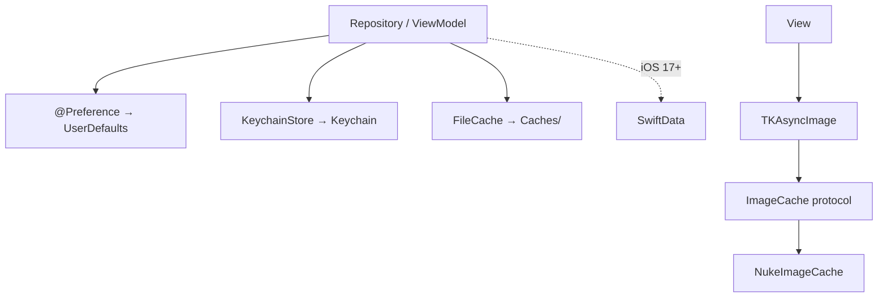

# TitanStorage

[← Về tổng quan](../README.md)

## 1. Tóm tắt

TitanStorage lưu dữ liệu trên máy: cài đặt nhỏ qua UserDefaults có kiểu, dữ liệu nhạy cảm qua Keychain, file cache, cache ảnh, và tùy chọn SwiftData cho dữ liệu có cấu trúc.

## 2. Trách nhiệm

**Làm:**
- Property wrapper `@Preference` đọc/ghi UserDefaults có kiểu và giá trị mặc định.
- `KeychainStore` lưu token, mật khẩu, khóa bí mật.
- `FileCache` lưu dữ liệu `Codable` ra file, có hạn sống (TTL).
- `ImageCache` bọc thư viện ảnh (Nuke, đề xuất) sau protocol, kèm view `TKAsyncImage`.
- Tùy chọn: helper tạo `ModelContainer` cho SwiftData (chỉ iOS 17+).

**Không làm:**
- Không đồng bộ dữ liệu với server (đồng bộ offline để làm sau).
- Không gọi network trừ việc tải ảnh bên trong `ImageCache`.
- Không biết model nghiệp vụ của app.

## 3. Sơ đồ



## 4. API chính

```swift
// UserDefaults có kiểu
public struct PreferenceKey<Value: Codable & Sendable>: Sendable {
    public let name: String
    public let defaultValue: Value
    public init(_ name: String, default defaultValue: Value) { }
}

@propertyWrapper
public struct Preference<Value: Codable & Sendable>: DynamicProperty {
    let key: PreferenceKey<Value>
    let store: UserDefaults
    public init(_ key: PreferenceKey<Value>, store: UserDefaults = .standard) {
        self.key = key; self.store = store
    }
    public var wrappedValue: Value {
        get { store.decoded(Value.self, for: key.name) ?? key.defaultValue }
        nonmutating set { store.encode(newValue, for: key.name) }
    }
    public var projectedValue: Binding<Value> {
        Binding(get: { wrappedValue }, set: { wrappedValue = $0 })
    }
}

// Keychain
public protocol SecureStore: Sendable {
    func set(_ data: Data, for key: String) throws(TitanError)
    func data(for key: String) throws(TitanError) -> Data?
    func remove(_ key: String) throws(TitanError)
}
public struct KeychainStore: SecureStore {
    public init(service: String, accessGroup: String? = nil) { }
}

// File cache
public protocol DataCache: Sendable {
    func save<T: Codable & Sendable>(_ value: T, for key: String, ttl: Duration?) async throws(TitanError)
    func load<T: Codable & Sendable>(_ type: T.Type, for key: String) async throws(TitanError) -> T?
    func clear() async
}
public actor FileCache: DataCache {
    public init(folder: String = "TitanCache") { }
}

// Cache ảnh
public protocol ImageCache: Sendable {
    func image(for url: URL) async throws(TitanError) -> UIImage
    func prefetch(_ urls: [URL])
    func clearMemory()
}
public struct TKAsyncImage: View {
    public init(url: URL?, placeholder: Image? = nil) { }
    public var body: some View { EmptyView() }
}
```

`ImageCache` được đưa xuống view qua `EnvironmentValues.imageCache`. Bản cài đặt Nuke nằm trong target con `TitanStorageNuke` để app nào không cần thì không kéo Nuke vào.

## 5. Design pattern áp dụng và lý do

| Pattern | Ở đâu | Lý do |
| --- | --- | --- |
| Property wrapper | `@Preference` | Khai báo một dòng, có kiểu, không gõ sai tên khóa |
| Adapter | `ImageCache` → Nuke | Đổi sang Kingfisher chỉ cần viết adapter mới |
| Facade | `KeychainStore` | Giấu API C rườm rà của Security framework |
| Actor | `FileCache` | Đọc/ghi file an toàn khi gọi đồng thời (Swift 6) |
| Environment injection | `imageCache` | Mọi `TKAsyncImage` dùng chung một cache |

## 6. Cấu trúc thư mục

```
Sources/TitanStorage/
├── Preferences/     # Preference.swift, PreferenceKey.swift
├── Keychain/        # SecureStore.swift, KeychainStore.swift
├── FileCache/       # DataCache.swift, FileCache.swift
├── Image/           # ImageCache.swift, TKAsyncImage.swift, EnvironmentKey
├── SwiftData/       # ModelContainer+Titan.swift (@available iOS 17)
└── Mock/            # InMemorySecureStore, InMemoryDataCache, MockImageCache
Sources/TitanStorageNuke/
└── NukeImageCache.swift
Tests/TitanStorageTests/
```

## 7. App sử dụng thế nào

```swift
// Khai báo khóa của App 1
extension PreferenceKey where Value == Bool {
    static let hasSeenOnboarding = PreferenceKey("hasSeenOnboarding", default: false)
}

// AppContainer.swift
let secureStore: any SecureStore = KeychainStore(service: "com.titan.app1")
let dataCache: any DataCache = FileCache()
let imageCache: any ImageCache = NukeImageCache(memoryLimitMB: 100)

// Root
RootView().environment(\.imageCache, container.imageCache)

// Trong view
struct OnboardingGate: View {
    @Preference(.hasSeenOnboarding) var seen
    var body: some View {
        if seen { HomeView() } else { OnboardingView { seen = true } }
    }
}

// Trong view danh sách
TKAsyncImage(url: item.thumbnailURL)
```

## 8. Test

- `InMemorySecureStore` và `InMemoryDataCache` thay thế Keychain và file thật.
- `@Preference` nhận `UserDefaults(suiteName:)` riêng cho test, xóa sau mỗi test.
- `MockImageCache` trả ảnh mẫu ngay, dùng cho preview và snapshot test.
- Test `FileCache` hết hạn TTL bằng cách truyền `ttl: .zero`.

```swift
let store = InMemorySecureStore()
try store.set(Data("abc".utf8), for: "token")
XCTAssertEqual(try store.data(for: "token"), Data("abc".utf8))
```

## 9. Checklist cho App 1

- [ ] Liệt kê các khóa `PreferenceKey` của App 1 trong một file
- [ ] Lưu token đăng nhập vào `KeychainStore`, không vào UserDefaults
- [ ] Tạo `NukeImageCache` và inject qua Environment
- [ ] Dùng `TKAsyncImage` cho mọi ảnh từ URL
- [ ] Xóa Keychain và cache khi đăng xuất hoặc xóa tài khoản
- [ ] Quyết định có dùng SwiftData không (cần iOS 17, đánh dấu `@available`)
- [ ] Khai báo lý do dùng UserDefaults trong privacy manifest
