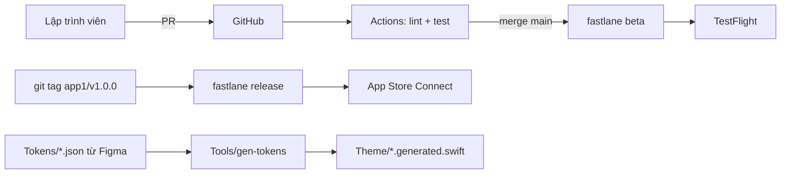

# Tooling: tạo app, môi trường, CI/CD

[← Về tổng quan](../README.md)

## 1. Một câu tóm tắt

Tooling gồm mẫu tạo app mới, cấu hình môi trường, script sinh token từ Figma, lint, fastlane, CI và cách đánh phiên bản kit, để mọi app được dựng và phát hành theo cùng một cách.

## 2. Trách nhiệm

- `Templates/NewApp`: tạo app mới đã nối sẵn kit, theme, `AppContainer`, 3 môi trường.
- `Config/*.xcconfig`: tách Dev, Staging, Prod; giữ bí mật ngoài git.
- `Tools/`: script sinh code Swift từ token JSON của Figma.
- SwiftLint: giữ code style thống nhất (xem [Conventions.md](../Conventions.md)).
- fastlane: lane `test`, `beta`, `release`.
- GitHub Actions: chạy lint và test cho mỗi PR, đẩy TestFlight khi merge.
- Phiên bản kit: tag semver và `CHANGELOG.md`.

## 3. Sơ đồ



## 4. API chính

### Tạo app mới trong 3 bước

```bash
# 1. Tạo app từ mẫu
tuist scaffold NewApp --name App2 --bundle-id com.<company>.app2
# 2. Điền bí mật (copy từ mẫu, không commit)
cp Apps/App2/Config/Secrets.example.xcconfig Apps/App2/Config/Secrets.xcconfig
# 3. Sinh project và mở
tuist install && tuist generate App2
```

Mẫu tạo ra: `App2App.swift`, `AppContainer.swift`, `AppConfig.swift`, `Theme/App2Theme.swift`, 3 file xcconfig, `Localizable.xcstrings`, `PrivacyInfo.xcprivacy`.

### Môi trường

```
// Apps/App1/Config/Prod.xcconfig
#include "Shared.xcconfig"
#include? "Secrets.xcconfig"
APP_ENV = prod
API_BASE_URL = https:/$()/api.example.com
BUNDLE_ID_SUFFIX =
APP_DISPLAY_NAME = App1
```

Dev và Staging dùng `BUNDLE_ID_SUFFIX = .dev` / `.staging` để cài song song trên máy. `AppConfig` đọc giá trị qua `Info.plist`. File `GoogleService-Info.plist` có một bản cho mỗi môi trường, chọn bằng build phase.

Bí mật (`Secrets.xcconfig`, `GoogleService-Info*.plist`, khóa API) nằm trong `.gitignore`. Trên CI, chúng được tạo lại từ GitHub Secrets. Chứng chỉ ký app quản lý bằng `fastlane match` trong repo riêng có mã hóa.

### Sinh token từ Figma

```bash
swift run --package-path Tools gen-tokens \
  --input Tokens/app1.tokens.json \
  --output Apps/App1/Theme/App1Tokens.generated.swift
```

File `.generated.swift` không sửa tay. Đổi design thì xuất lại JSON từ Figma và chạy lại script.

### SwiftLint

`.swiftlint.yml` ở gốc repo. Bật `force_unwrapping`, `force_try`, `file_length`, `type_body_length`; bỏ qua file `*.generated.swift`. Chạy bằng `swiftlint --strict` trên CI.

### fastlane

```bash
bundle exec fastlane test app:App1              # lint + unit + snapshot test
bundle exec fastlane beta app:App1              # tăng build number, build Staging, đẩy TestFlight
bundle exec fastlane release app:App1           # build Prod, đẩy App Store Connect để review
```

### GitHub Actions

```yaml
# .github/workflows/ci.yml
on: [pull_request]
jobs:
  test:
    runs-on: macos-15
    steps:
      - uses: actions/checkout@v4
      - run: tuist install && tuist generate --no-open
      - run: bundle exec fastlane test app:App1
```

Thêm `beta.yml` chạy khi merge vào `main`, `release.yml` chạy khi có tag `app1/v*`.

### Phiên bản kit

- Kit dùng tag `kit/vMAJOR.MINOR.PATCH`. App dùng tag `app1/vX.Y.Z`.
- MAJOR: đổi API làm app phải sửa code. MINOR: thêm tính năng. PATCH: sửa lỗi.
- Mọi PR sửa kit thêm một dòng vào mục `Unreleased` của `CHANGELOG.md`.
- Khi app nằm cùng repo, app dùng kit theo đường dẫn local. Tag giúp biết app đã phát hành với bản kit nào.

## 5. Design pattern áp dụng và lý do

| Pattern | Dùng ở đâu | Lý do |
| --- | --- | --- |
| Template | `Templates/NewApp` | App mới đúng cấu trúc ngay từ đầu |
| Configuration by environment | xcconfig Dev/Staging/Prod | Một codebase, nhiều môi trường, không `#if` rải rác |
| Code generation | `gen-tokens` | Token Figma là nguồn duy nhất, không gõ tay mã màu |
| Pipeline | CI → beta → release | Mỗi bước tự động, lặp lại được |

## 6. Cấu trúc thư mục

```
titankit/
├── Templates/NewApp/          # mẫu Tuist scaffold
├── Tokens/                    # JSON xuất từ Figma
├── Tools/                     # Swift package chứa gen-tokens
├── fastlane/{Fastfile, Appfile, Matchfile}
├── .github/workflows/{ci, beta, release}.yml
├── .swiftlint.yml
├── CHANGELOG.md
└── Apps/App1/Config/{Shared, Dev, Staging, Prod}.xcconfig + Secrets.example.xcconfig
```

## 7. App sử dụng thế nào

1. Tạo app bằng 3 bước ở mục 4.
2. Điền `Secrets.xcconfig` và đặt `GoogleService-Info` của từng môi trường.
3. Chọn scheme `App1-Dev` khi phát triển, `App1-Staging` khi test nội bộ.
4. Xuất token Figma vào `Tokens/` và chạy `gen-tokens`.
5. Mở PR theo quy tắc ở [Conventions.md](../Conventions.md); CI phải xanh mới được merge.

## 8. Test

- Chạy `tuist scaffold` trên CI định kỳ để chắc mẫu NewApp vẫn build được.
- `gen-tokens` có test với file JSON mẫu và so với output mong đợi.
- Kiểm tra `git status` sạch sau khi build (không có bí mật bị sinh ra trong vùng commit).

## 9. Checklist cho App 1

- [ ] Có quyền ghi vào repo và tài khoản Apple Developer.
- [ ] Chốt bundle id `com.<company>.app1`.
- [ ] Tạo App1 từ `Templates/NewApp`.
- [ ] Tạo 3 xcconfig và `Secrets.xcconfig` (không commit).
- [ ] Thiết lập `fastlane match` và App Store Connect API key trong GitHub Secrets.
- [ ] CI chạy lint + test trên mỗi PR.
- [ ] Lane `beta` đẩy được bản đầu lên TestFlight.
- [ ] Tạo `CHANGELOG.md` và tag `kit/v0.1.0`.
